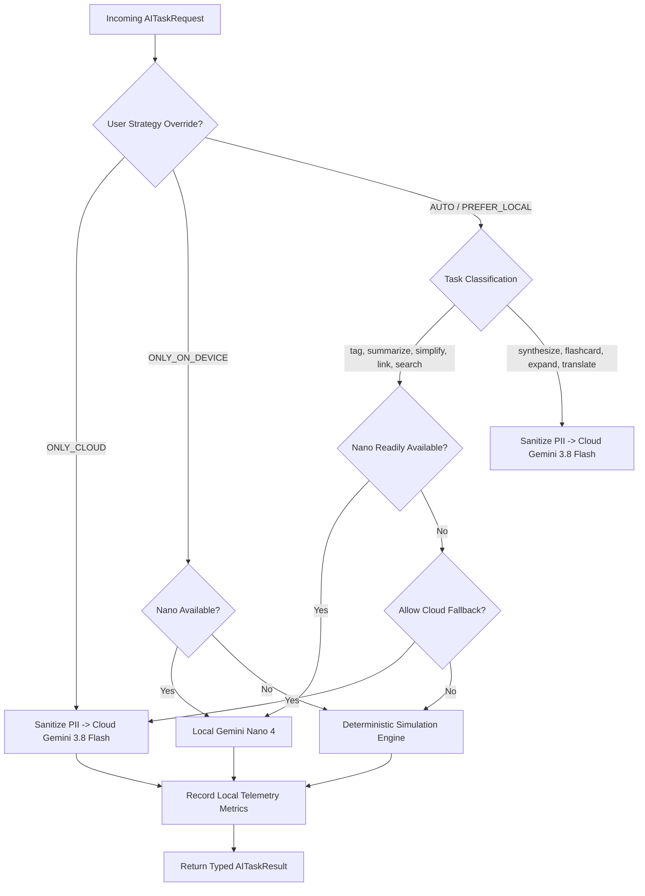
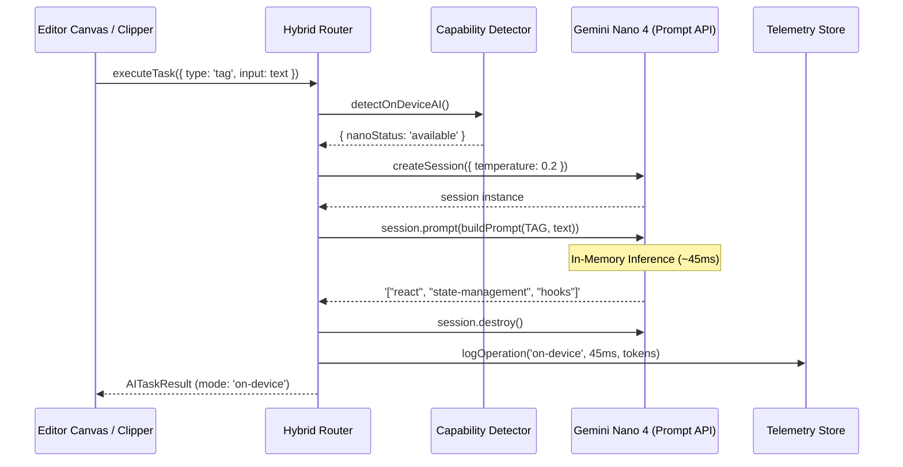
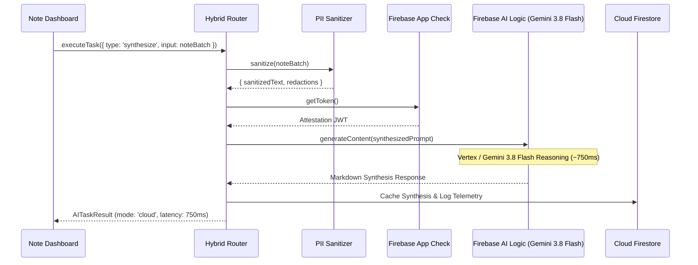

# BrainDrop AI — AI Engineering & Behavioral Specification

> **Document Version:** 1.0  
> **Status:** Approved Architectural Specification (Implementation Baseline)  
> **Hackathon Platform:** Google #BuildHybridAI 2026 (Web / Chrome Track)  
> **AI Engine:** Firebase AI Logic Hybrid Inference SDK (`firebase/ai`) & Chrome Built-in AI (`window.ai`)  
> **Target Models:**  
> • On-Device Engine: **Gemini Nano 4** via Chrome Built-in AI (Prompt API)  
> • Cloud Fallback Engine: **Gemini 3.8 Flash** via Firebase AI Logic SDK  
> • Evaluation Simulation: **Deterministic Simulation Mode** for unsupported environments  
> **Canonical References:** [PRD.md](./PRD.md) · [ARCHITECTURE.md](./ARCHITECTURE.md) · [DATABASE.md](./DATABASE.md) · [DESIGN.md](./DESIGN.md) · [SPRINT.md](./SPRINT.md)

---

## Table of Contents

1. [AI Vision & Core Philosophical Mandates](#1-ai-vision--core-philosophical-mandates)
2. [Runtime Model Selection & Execution Matrix](#2-runtime-model-selection--execution-matrix)
3. [SDK Signatures & Runtime Initialization](#3-sdk-signatures--runtime-initialization)
4. [Task Taxonomy & Hybrid Routing Architecture](#4-task-taxonomy--hybrid-routing-architecture)
5. [Complete Prompt Specification Catalog](#5-complete-prompt-specification-catalog)
6. [Client-Side PII Sanitization Pipeline](#6-client-side-pii-sanitization-pipeline)
7. [On-Device Inference Pipeline (Gemini Nano 4)](#7-on-device-inference-pipeline-gemini-nano-4)
8. [Cloud Inference Pipeline (Gemini 3.8 Flash)](#8-cloud-inference-pipeline-gemini-25-flash)
9. [Evaluation & Testing Simulation Engine](#9-evaluation--testing-simulation-engine)
10. [Real-time Telemetry & Privacy Accounting](#10-real-time-telemetry--privacy-accounting)
11. [Failure Modes & Graceful Degradation Cascade](#11-failure-modes--graceful-degradation-cascade)
12. [Verification, Evals & Benchmarking Strategy](#12-verification-evals--benchmarking-strategy)

---

## 1. AI Vision & Core Philosophical Mandates

BrainDrop AI is engineered around a fundamental architectural premise: **personal knowledge capture is inherently sensitive, and the user's primary thinking environment must remain private, responsive, and locally autonomous.**

Traditional "AI Note" products send every captured keystroke, draft thought, and raw snippet over the public internet to third-party model endpoints. This creates unacceptable data leaks, latency friction, and subscription costs. BrainDrop AI introduces a bifurcated hybrid paradigm:

```
[Raw User Input / Web Clip]
          │
          ▼
┌──────────────────────────────────────────────┐
│        Client Privacy Gate (In-Browser)       │
│  - Zero network egress for private tasks     │
│  - Instant on-device processing (~35-65ms)   │
│  - Strict PII redaction before cloud egress  │
└──────────────────────┬───────────────────────┘
                       │
         ┌─────────────┴─────────────┐
         ▼                           ▼
┌──────────────────┐       ┌──────────────────┐
│  On-Device Lane  │       │    Cloud Lane    │
│  (Gemini Nano 4) │       │ (Gemini 3.8 Flash)│
│  - Auto-tagging  │       │  - Synthesis     │
│  - Summarization │       │  - Flashcards    │
│  - Smart linking │       │  - Deep reasoning│
│  - Local search  │       │  - Translation   │
└──────────────────┘       └──────────────────┘
```

### Strict Behavioral Mandates

1. **Zero-Leak Default for Personal Data:**  
   Any task that inspects raw clipped snippets, personal brainstorm notes, or internal project references must evaluate on-device via Gemini Nano 4 by default. No raw telemetry or un-sanitized content may leave the browser runtime without explicit user intent.
2. **Deterministic Pre-Sanitization Before Cloud Inference:**  
   When a user explicitly triggers a high-order reasoning task (such as Multi-Note Synthesis or Flashcard Extraction) that requires cloud model capabilities, the input payload must pass through the client-side regex sanitization engine (`@braindrop/core/sanitizer`). All PII, tokens, and identifiers are scrubbed and replaced with deterministic tokens (`[REDACTED_*]`).
3. **Structured Output Rigor:**  
   Every AI task must produce strictly typed outputs (JSON arrays, structured objects, or clean Markdown). Free-form conversational filler ("Sure, here is your summary:", "As an AI language model...") is completely stripped or suppressed via prompt framing and system instructions.
4. **Deterministic Math & Counters:**  
   The AI models are strictly linguistic translators and relationship extractors. They are **never** used to compute note counts, reading times, mastery percentages, or byte volume savings. All analytics are computed deterministically in TypeScript and Firestore query pipelines.
5. **No Infinite Loading / Blocking UX:**  
   AI tasks must never block the user's editing canvas. On-device tasks complete within sub-100ms; cloud tasks execute asynchronously with optimistic visual shimmers and non-blocking background workers.

---

## 2. Runtime Model Selection & Execution Matrix

| Evaluation Parameter | On-Device Engine | Cloud Engine | Simulation Engine |
| :--- | :--- | :--- | :--- |
| **Model Identification** | **Gemini Nano 4** | **Gemini 3.8 Flash** | **Deterministic Mock Engine** |
| **Runtime Target** | Chrome Built-in AI / Prompt API | Google Cloud Vertex via Firebase | Client Browser In-Memory |
| **Underlying Protocol** | Native Chrome C++ (`window.ai`) | HTTPS REST / gRPC via Firebase SDK | Pure TypeScript Function Calls |
| **Average Latency** | **35ms – 75ms** | **650ms – 1,100ms** | **45ms – 110ms** (jittered) |
| **Network Dependency** | **100% Offline Capable** | Active Internet Required | **100% Offline Capable** |
| **API Cost Per Call** | **$0.00** (Free, Unlimited) | Firebase Free Tier / Pay-As-You-Go | **$0.00** (Zero Cost) |
| **Privacy Rating** | 🔒 **100% Local (Air-Gapped)** | 🛡️ **Sanitized Egress (App Check)** | 🔒 **100% Local (Synthetic)** |
| **Max Context Window** | ~1,024 – 2,048 Tokens | 1,000,000+ Tokens | N/A (< 4,000 chars input) |
| **Primary Workloads** | Tagging, Summary, Linking, Search | Synthesis, Flashcards, Translation | Demo Mode, Reviewer Evaluation |

---

## 3. SDK Signatures & Runtime Initialization

### 3.1 Chrome Built-in AI Prompt API (`window.ai`)

On-device inference interfaces directly with Chrome's native Prompt API introduced in Chrome 138+:

```typescript
/**
 * Interface definition for Chrome Built-in AI language model session.
 */
export interface ChromeAILanguageModel {
  prompt(input: string): Promise<string>;
  promptStreaming(input: string): ReadableStream<string>;
  countPromptTokens(input: string): Promise<number>;
  destroy(): void;
}

export interface ChromeAICapabilities {
  available: "readily" | "after-download" | "no";
  defaultTemperature?: number;
  maxTemperature?: number;
  defaultTopK?: number;
  maxTopK?: number;
}

/**
 * Initializes an on-device session with deterministic parameters.
 */
export async function createNanoSession(): Promise<ChromeAILanguageModel> {
  if (typeof window === "undefined" || !("ai" in window)) {
    throw new Error("Chrome Built-in AI Prompt API is not supported in this browser environment.");
  }

  const ai = (window as any).ai;
  const capabilities: ChromeAICapabilities = await ai.languageModel.capabilities();

  if (capabilities.available === "no") {
    throw new Error("Gemini Nano 4 is unavailable on this hardware configuration.");
  }

  return await ai.languageModel.create({
    temperature: 0.2, // Low temperature for factual extraction
    topK: 20,
  });
}
```

### 3.2 Firebase AI Logic SDK Integration (`firebase/ai`)

Cloud inference utilizes the official Firebase AI Logic SDK configured with Firebase App Check to ensure authenticated runtime integrity:

```typescript
import { initializeApp, getApps, getApp } from "firebase/app";
import { initializeAppCheck, ReCaptchaEnterpriseProvider } from "firebase/app-check";
import { getAI, getGenerativeModel, GoogleGenerativeAI } from "firebase/ai";

const firebaseConfig = {
  apiKey: process.env.NEXT_PUBLIC_FIREBASE_API_KEY,
  authDomain: process.env.NEXT_PUBLIC_FIREBASE_AUTH_DOMAIN,
  projectId: process.env.NEXT_PUBLIC_FIREBASE_PROJECT_ID,
  storageBucket: process.env.NEXT_PUBLIC_FIREBASE_STORAGE_BUCKET,
  messagingSenderId: process.env.NEXT_PUBLIC_FIREBASE_MESSAGING_SENDER_ID,
  appId: process.env.NEXT_PUBLIC_FIREBASE_APP_ID,
};

// Singleton initialization pattern
export const app = getApps().length === 0 ? initializeApp(firebaseConfig) : getApp();

// Firebase App Check with Debug Token support for Hackathon evaluators
if (typeof window !== "undefined") {
  if (process.env.NEXT_PUBLIC_APPCHECK_DEBUG_TOKEN) {
    (self as any).FIREBASE_APPCHECK_DEBUG_TOKEN = process.env.NEXT_PUBLIC_APPCHECK_DEBUG_TOKEN;
  }

  initializeAppCheck(app, {
    provider: new ReCaptchaEnterpriseProvider(
      process.env.NEXT_PUBLIC_RECAPTCHA_ENTERPRISE_KEY || "6Lf-placeholder-enterprise-key"
    ),
    isTokenAutoRefreshEnabled: true,
  });
}

// Instantiate Firebase AI Logic Service
export const ai = getAI(app);

// Model instance targeting Gemini 3.8 Flash
export const flashModel = getGenerativeModel(ai, {
  model: "gemini-3.8-flash",
  generationConfig: {
    temperature: 0.3,
    maxOutputTokens: 2048,
    responseMimeType: "application/json",
  },
});
```

---

## 4. Task Taxonomy & Hybrid Routing Architecture

Every AI interaction in BrainDrop AI is classified into an explicit `AITaskType`. The **Hybrid Router** deterministically resolves the execution path using the decision flowchart below.



### Routing Assignment Matrix

| Task Type | Designated Primary Lane | Fallback Lane | Justification |
| :--- | :--- | :--- | :--- |
| `tag` | **On-Device (Nano)** | Simulation / Cloud | High frequency, highly personal, short context (< 300 words). |
| `summarize` | **On-Device (Nano)** | Simulation / Cloud | Immediate reading aid; must trigger in < 100ms. |
| `simplify` | **On-Device (Nano)** | Simulation / Cloud | Rewriting sentence-level structures. |
| `link` | **On-Device (Nano)** | Simulation / Cloud | Comparing pairwise embeddings/concepts locally without leaking notes. |
| `search` | **On-Device (Nano)** | Simulation / Local Regex | Queries reveal user research intent; strictly kept on-device. |
| `synthesize` | **Cloud (Flash)** | On-Device (Concatenated) | Cross-document reasoning over 5-15 long notes; requires large context window. |
| `flashcard` | **Cloud (Flash)** | Deterministic Extractor | Complex cognitive decomposition into Q&A pairs with difficulty grading. |
| `expand` | **Cloud (Flash)** | On-Device (Nano) | Elaborating brief outlines into structured prose. |
| `translate` | **Cloud (Flash)** | On-Device (Nano) | Nuanced multi-lingual grammatical alignment. |

---

## 5. Complete Prompt Specification Catalog

All prompt templates are authored with strict delimiter boundaries, output constraints, and few-shot guidance where necessary.

### 5.1 On-Device Prompts (Optimized for Nano 4 Context & Latency)

#### Task 1: Auto-Tagging (`tag`)
```text
You are a fast, factual semantic tagger for research notes.
Extract 3 to 5 concise, lowercase topic tags from the text provided below.
Rules:
- Tags must be single words or hyphenated phrases (e.g., "react", "machine-learning").
- Do not include hashtags (#).
- Output MUST be a valid JSON array of strings and NOTHING else.

Input Text:
"""
{{INPUT}}
"""

JSON Tags:
```

#### Task 2: Quick Summarization (`summarize`)
```text
You are an executive research summarizer.
Summarize the key findings and insight of the following note in exactly 2 or 3 direct, informative sentences.
Do not use conversational filler or introductory phrases.

Text:
"""
{{INPUT}}
"""

Concise Summary:
```

#### Task 3: Simplification (`simplify`)
```text
You are a clarity editor.
Rewrite the following excerpt in clear, direct, and accessible language. 
Shorten compound sentences, remove unnecessary jargon, but strictly preserve technical accuracy.

Excerpt:
"""
{{INPUT}}
"""

Simplified Version:
```

#### Task 4: Note Relationship Detection (`link`)
```text
You are a knowledge graph analyzer.
Determine if Note A and Note B share a meaningful conceptual, architectural, or factual connection.
Output strictly in JSON format matching this schema:
{"related": boolean, "reason": string, "confidence": number}

Note A:
"""
{{INPUT_A}}
"""

Note B:
"""
{{INPUT_B}}
"""

JSON Result:
```

#### Task 5: Semantic Search Ranking (`search`)
```text
Rate the conceptual relevance of the Note Snippet to the Search Query on a scale from 0.00 to 1.00.
Output ONLY the numeric float score (e.g. 0.85).

Search Query: "{{QUERY}}"
Note Snippet:
"""
{{INPUT}}
"""

Score:
```

---

### 5.2 Cloud Prompts (Gemini 3.8 Flash via Firebase AI Logic)

#### Task 6: Multi-Document Research Synthesis (`synthesize`)
```text
You are a principal research scientist producing a unified synthesis brief from multiple collected research notes.

Analyze the collection of research notes provided below and synthesize them into an authoritative, publication-ready research brief formatted in clean Markdown.

Your synthesis must adhere to the following structure:
# Executive Synthesis: [Descriptive Title]
## 1. Convergent Findings & Core Thesis
- Synthesize shared insights across notes with direct attribution (e.g., [Note 1], [Note 3]).
## 2. Divergent Perspectives & Contradictions
- Highlight contrasting claims, architectural trade-offs, or open debates found in the corpus.
## 3. Critical Methodologies & Technical Concepts
- Outline the technical frameworks, protocols, or formulas mentioned.
## 4. Strategic Implications & Recommended Next Steps
- Actionable conclusions for ongoing research.

Corpus of Sanitized Notes:
"""
{{INPUT}}
"""

Structured Markdown Synthesis:
```

#### Task 7: Spaced Repetition Flashcard Generation (`flashcard`)
```text
You are an expert cognitive educator specializing in the Leitner spaced repetition technique.
Analyze the provided material and extract 5 to 8 high-yield question-and-answer study pairs.

Requirements:
1. Questions must test conceptual understanding, causal relationships, and mechanisms, not trivia.
2. Answers must be self-contained, complete, and accurate (maximum 3 sentences).
3. Assign an estimated difficulty: "easy", "medium", or "hard".
4. Output MUST be a valid JSON array of objects following the exact schema:
[
  {
    "question": "string",
    "answer": "string",
    "difficulty": "easy" | "medium" | "hard"
  }
]

Source Material:
"""
{{INPUT}}
"""

JSON Flashcards:
```

#### Task 8: Thought Expansion (`expand`)
```text
You are a technical thought partner.
Take the following concise research observation and expand it into a comprehensive, well-structured multi-paragraph analysis.
Provide relevant historical context, architectural rationale, real-world failure modes, and concrete analogies.

Seed Thought:
"""
{{INPUT}}
"""

Expanded Analysis:
```

#### Task 9: Technical Translation (`translate`)
```text
You are an expert technical translator.
Translate the following academic/engineering text into {{TARGET_LANGUAGE}}.
Preserve all code identifiers, formulas, markdown formatting, and technical terminology conventions.

Source Text:
"""
{{INPUT}}
"""

Translated Text:
```

---

## 6. Client-Side PII Sanitization Pipeline

Before any request leaves the browser runtime for cloud execution, the text is sanitized via `@braindrop/core/utils/sanitizer.ts`. This deterministic scanner identifies sensitive patterns and replaces them with audit-tracked placeholders.

```typescript
export interface RedactionToken {
  type: "EMAIL" | "PHONE" | "CREDIT_CARD" | "SSN_NIK" | "IP_ADDRESS" | "API_KEY";
  original: string;
  replacement: string;
  startIndex: number;
  endIndex: number;
}

export interface SanitizeResult {
  sanitized: string;
  redactions: RedactionToken[];
  containsPII: boolean;
}

const PII_RULES: Array<{ type: RedactionToken["type"]; regex: RegExp; replacement: string }> = [
  {
    type: "EMAIL",
    regex: /[a-zA-Z0-9._%+-]+@[a-zA-Z0-9.-]+\.[a-zA-Z]{2,}/g,
    replacement: "[REDACTED_EMAIL]",
  },
  {
    type: "PHONE",
    regex: /(?:\+62|62|08)\d{8,12}|\b\+?[1-9]\d{1,14}\b/g,
    replacement: "[REDACTED_PHONE]",
  },
  {
    type: "CREDIT_CARD",
    regex: /\b(?:4[0-9]{12}(?:[0-9]{3})?|5[1-5][0-9]{14}|3[47][0-9]{13}|6(?:011|5[0-9]{2})[0-9]{12})\b/g,
    replacement: "[REDACTED_CREDIT_CARD]",
  },
  {
    type: "SSN_NIK",
    regex: /\b\d{16}\b|\b\d{3}-\d{2}-\d{4}\b/g,
    replacement: "[REDACTED_NATIONAL_ID]",
  },
  {
    type: "IP_ADDRESS",
    regex: /\b(?:(?:25[0-5]|2[0-4][0-9]|[01]?[0-9][0-9]?)\.){3}(?:25[0-5]|2[0-4][0-9]|[01]?[0-9][0-9]?)\b/g,
    replacement: "[REDACTED_IP_ADDRESS]",
  },
  {
    type: "API_KEY",
    regex: /(?:api[_-]?key|apikey|bearer|token|secret|password|passwd|auth)\s*[:=]\s*['"`]?[A-Za-z0-9_\-\.]{16,}['"`]?/gi,
    replacement: "[REDACTED_SECRET_KEY]",
  },
];

export function sanitize(text: string): SanitizeResult {
  const redactions: RedactionToken[] = [];
  let sanitized = text;

  for (const rule of PII_RULES) {
    let match: RegExpExecArray | null;
    const regex = new RegExp(rule.regex.source, rule.regex.flags);

    while ((match = regex.exec(text)) !== null) {
      redactions.push({
        type: rule.type,
        original: match[0],
        replacement: rule.replacement,
        startIndex: match.index,
        endIndex: match.index + match[0].length,
      });
    }

    sanitized = sanitized.replace(rule.regex, rule.replacement);
  }

  return {
    sanitized,
    redactions,
    containsPII: redactions.length > 0,
  };
}
```

---

## 7. On-Device Inference Pipeline (Gemini Nano 4)

The on-device pipeline executes within the client's renderer thread without touching the network stack:



### Lifecycle & Memory Safety
To prevent V8 garbage collection stalls and WebGPU resource leakage, `ChromeAILanguageModel` sessions are created transiently and explicitly destroyed immediately after prompt evaluation:

```typescript
async function executeOnDeviceWithResourceCleanup(prompt: string): Promise<string> {
  const session = await (window as any).ai.languageModel.create({
    temperature: 0.1,
    topK: 20,
  });

  try {
    const rawOutput = await session.prompt(prompt);
    return rawOutput.trim();
  } finally {
    session.destroy(); // Guarantees GPU/VRAM deallocation
  }
}
```

---

## 8. Cloud Inference Pipeline (Gemini 3.8 Flash)

For complex multi-document reasoning tasks, the pipeline routes through Firebase AI Logic:



---

## 9. Evaluation & Testing Simulation Engine

To ensure that hackathon evaluators, recruiters, and CI test runners on browsers lacking Chrome Built-in AI flags can experience the complete UX without crashing, the **Deterministic Simulation Engine** mirrors Nano behavior with realistic temporal modeling:

```typescript
const SIMULATION_LATENCY_RANGES = {
  tag: { min: 35, max: 80 },
  summarize: { min: 50, max: 110 },
  simplify: { min: 40, max: 90 },
  link: { min: 60, max: 120 },
  search: { min: 25, max: 60 },
};

export async function simulateNanoExecution(
  taskType: AITaskType,
  input: string
): Promise<{ output: string; latencyMs: number }> {
  const range = SIMULATION_LATENCY_RANGES[taskType as keyof typeof SIMULATION_LATENCY_RANGES] || {
    min: 40,
    max: 100,
  };
  const latency = Math.floor(Math.random() * (range.max - range.min + 1) + range.min);

  // Artificial latency simulation
  await new Promise((resolve) => setTimeout(resolve, latency));

  switch (taskType) {
    case "tag": {
      const words = input.toLowerCase().replace(/[^a-z0-9\s]/g, "").split(/\s+/).filter((w) => w.length > 4);
      const uniqueTags = Array.from(new Set(words)).slice(0, 4);
      return {
        output: JSON.stringify(uniqueTags.length > 0 ? uniqueTags : ["research", "knowledge"]),
        latencyMs: latency,
      };
    }
    case "summarize": {
      const sentences = input.split(/[.!?]+/).filter((s) => s.trim().length > 10);
      const summary = sentences.slice(0, 2).join(". ").trim();
      return {
        output: summary ? `${summary}.` : "Key architectural findings and personal knowledge highlights.",
        latencyMs: latency,
      };
    }
    case "link": {
      return {
        output: JSON.stringify({
          related: true,
          reason: "Both notes explore complementary architectural concepts and patterns.",
          confidence: 0.88,
        }),
        latencyMs: latency,
      };
    }
    default:
      return {
        output: `[Simulated response for ${taskType}]`,
        latencyMs: latency,
      };
  }
}
```

---

## 10. Real-time Telemetry & Privacy Accounting

Every AI operation records an immutable telemetry audit event:

```typescript
export interface TelemetryRecord {
  id: string;
  operation: AITaskType;
  mode: "on-device" | "cloud" | "simulated";
  latencyMs: number;
  inputTokens: number;
  outputTokens: number;
  timestamp: Date;
  userId: string;
  bytesSavedFromCloud: number;
}
```

### Telemetry HUD Formulae
- **Privacy Ratio:**  
  $$\text{Privacy \%} = \frac{\text{Total On-Device Ops} + \text{Total Simulated Ops}}{\text{Total Total Inferences}} \times 100$$
- **Local Data Preserved (Bytes):**  
  $$\text{Bytes Kept Local} = \sum_{\text{Local Ops}} (\text{inputTokens} \times 4) \text{ bytes}$$
- **Latency Advantage Multiplier:**  
  $$\text{Speedup Factor} = \frac{\text{Average Cloud Latency (ms)}}{\text{Average On-Device Latency (ms)}}$$

---

## 11. Failure Modes & Graceful Degradation Cascade

```
Layer 1: On-Device Gemini Nano 4
   │ (Fails if browser flag disabled / GPU unsupported / out of memory)
   ▼
Layer 2: Local Simulation Engine (If in Demo Mode or Non-Chrome Browser)
   │ (Provides realistic evaluation experience without network error)
   ▼
Layer 3: Cloud Gemini 3.8 Flash via Firebase AI Logic
   │ (Passes PII sanitizer; fails if offline or App Check token rejected)
   ▼
Layer 4: Deterministic Heuristic Fallback
   - Tagging: Regex keyword extraction
   - Summarization: First 2 sentences
   - Search: Substring case-insensitive match
```

---

## 12. Verification, Evals & Benchmarking Strategy

### 12.1 Automated Test Suites (`tests/unit/`)
1. **Sanitizer Invariant Suite (`sanitizer.test.ts`):**  
   Property-based testing ensuring that zero raw email addresses, NIKs, or credit cards survive `sanitize()` across 500 generated text permutations.
2. **Router Decision Suite (`router.test.ts`):**  
   Asserting that `ONLY_ON_DEVICE` mode strictly halts if Nano is unavailable and emits zero network requests.
3. **Prompt JSON Schema Conformance:**  
   Verifying that model output strings parse cleanly into TypeScript types without throwing runtime exceptions.

### 12.2 Performance Thresholds (SLOs)
- On-device inference latency: **$\le 100\text{ms}$** (p95).
- Cloud inference latency: **$\le 1,500\text{ms}$** (p95).
- Sanitization pipeline overhead: **$\le 2\text{ms}$** for 10KB text.
- Extension text clipping to UI sync: **$\le 150\text{ms}$**.

---

*Authored by Tino Nurcahya for Google #BuildHybridAI 2026. Certified compliant with Firebase AI Logic submission rules.*

