# 🧠 BrainDrop AI — System Architecture Blueprint

| Attribute        | Value                                                  |
| :--------------- | :----------------------------------------------------- |
| **Document**     | System Architecture Blueprint                          |
| **Version**      | `1.0.0`                                                |
| **Status**       | ✅ Active — Hackathon Build                             |
| **Last Updated** | 2026-11-16                                             |
| **Author**       | Tino Nurcahya                                          |
| **Project**      | BrainDrop AI — Your Second Brain, On-Device            |
| **Hackathon**    | Firebase AI Logic #BuildHybridAI 2026                  |
| **Live URL**     | [brain.tinonurcahya.dev](https://brain.tinonurcahya.dev) |
| **Repository**   | `braindrop-ai` (monorepo)                              |

---

## Table of Contents

1. [Architectural Philosophy & Principles](#1-architectural-philosophy--principles)
2. [Target Stack](#2-target-stack)
3. [High-Level System Architecture](#3-high-level-system-architecture)
4. [Monorepo Package Architecture](#4-monorepo-package-architecture)
5. [Detailed Layer Breakdown](#5-detailed-layer-breakdown)
6. [Hybrid AI Inference Architecture](#6-hybrid-ai-inference-architecture)
7. [Data Flow Diagrams](#7-data-flow-diagrams)
8. [API Route Architecture](#8-api-route-architecture)
9. [State Management Architecture](#9-state-management-architecture)
10. [Chrome Extension Architecture](#10-chrome-extension-architecture)
11. [Data Model & Firestore Schema](#11-data-model--firestore-schema)
12. [Security Architecture](#12-security-architecture)
13. [Deployment Architecture](#13-deployment-architecture)
14. [Performance Architecture](#14-performance-architecture)
15. [Error Handling & Fallback Strategy](#15-error-handling--fallback-strategy)
16. [Related Documents](#16-related-documents)

---

## 1. Architectural Philosophy & Principles

BrainDrop AI is built on the conviction that **AI-powered knowledge tools should not require users to surrender their data to the cloud**. Every architectural decision is guided by the following numbered principles:

> [!IMPORTANT]
> These principles are non-negotiable and inform every technical decision throughout the system.

1. **Privacy-First Inference** — All privacy-sensitive AI operations (tagging, summarization, search, linking) execute on-device via Gemini Nano 4. User content never leaves the browser unless the user explicitly invokes a cloud-requiring task.

2. **Hybrid by Design, Not by Accident** — The system is built from day one to route AI tasks intelligently between on-device (Gemini Nano 4) and cloud (Gemini 3.8 Flash). The Hybrid Router is a first-class architectural component, not an afterthought.

3. **Graceful Degradation** — If Gemini Nano is unavailable (non-Chrome browser, unsupported device, model not downloaded), the system falls back to a Simulation Mode that demonstrates the full UX with deterministic mock responses.

4. **Transparency Through Telemetry** — Every AI operation is logged with its execution mode (on-device / cloud / simulated), latency, and token count. A real-time Telemetry HUD gives users full visibility into where their data is processed.

5. **PII Never Reaches the Cloud Unprotected** — Before any cloud inference request, text passes through a multi-pattern PII sanitizer that redacts email addresses, phone numbers, credit card numbers, national IDs (NIK), IP addresses, and API keys/secrets.

6. **Monorepo Cohesion** — Shared types, utilities, and AI logic live in dedicated packages (`@braindrop/core`, `@braindrop/ai-logic`) consumed by both the web app and the extension. A single `turbo build` validates the entire dependency graph.

7. **Extension as First-Class Citizen** — The Chrome Extension is not a bolt-on; it is the primary capture interface. The architecture treats the extension ↔ web app data flow as a core system pathway.

8. **Knowledge is a Graph** — Notes are not flat documents in a folder. Every note can be linked to other notes, and the system actively discovers connections via AI-powered smart linking. The knowledge graph is a first-class data structure.

9. **Ship Fast, Iterate Faster** — Next.js 15 App Router, React 19, and Tailwind CSS 4 enable rapid iteration. shadcn/ui and Framer Motion provide a polished UI without custom CSS burden.

10. **Observability by Default** — Structured telemetry records capture every AI operation, enabling the dashboard to display inference breakdowns, latency histograms, and privacy-preservation metrics.

---

## 2. Target Stack

| Layer               | Technology                                     | Version    | Purpose                                    |
| :------------------ | :--------------------------------------------- | :--------- | :----------------------------------------- |
| **Framework**       | Next.js (App Router)                           | 15.5       | Full-stack React framework, SSR/SSG        |
| **UI Library**      | React                                          | 19.3       | Component rendering, hooks, Suspense       |
| **Language**        | TypeScript                                     | 5.9        | Static typing across the monorepo          |
| **Styling**         | Tailwind CSS                                   | 4.x        | Utility-first CSS, CSS variables, JIT      |
| **UI Components**   | shadcn/ui                                      | latest     | Accessible, composable primitives          |
| **Animation**       | Framer Motion                                  | latest     | Layout animations, transitions, gestures   |
| **Rich Text**       | Tiptap (ProseMirror)                           | 2.x        | Extensible rich text editor                |
| **Graph Viz**       | React Flow                                     | latest     | Interactive knowledge graph visualization  |
| **State**           | Zustand                                        | 5.x        | Lightweight, hook-based state management   |
| **AI (On-Device)**  | Gemini Nano 4 via `window.ai` Prompt API       | Chrome 138+| On-device LLM inference                    |
| **AI (Cloud)**      | Gemini 3.8 Flash via Firebase AI Logic SDK     | latest     | Cloud LLM inference                        |
| **Auth**            | Firebase Auth (Google Sign-In)                 | latest     | User authentication                        |
| **Database**        | Cloud Firestore                                | latest     | NoSQL document database with real-time sync|
| **App Security**    | Firebase App Check                             | latest     | Request attestation, abuse prevention      |
| **Extension**       | Chrome Extension Manifest V3                   | MV3        | Content script, popup, side panel, SW       |
| **Monorepo**        | Turborepo + npm workspaces                     | latest     | Build orchestration, caching, dep graph    |
| **Hosting**         | Vercel                                         | —          | Edge hosting, serverless functions          |
| **CI/CD**           | GitHub Actions                                 | —          | Lint, type-check, test, deploy pipeline    |

---

## 3. High-Level System Architecture

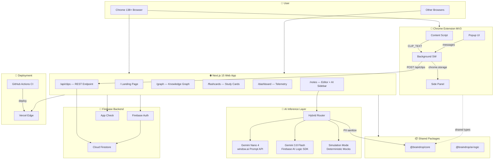

---

## 4. Monorepo Package Architecture

```
braindrop-ai/                          # Root — Turborepo + npm workspaces
├── turbo.json                         # Pipeline config: build, lint, type-check
├── package.json                       # Workspace root, shared devDependencies
├── .github/
│   └── workflows/                     # GitHub Actions CI pipeline
│
├── apps/
│   ├── web/                           # Next.js 15 web application
│   │   ├── src/
│   │   │   └── app/
│   │   │       ├── layout.tsx         # Root layout: Navbar + TelemetryHUD
│   │   │       ├── page.tsx           # Landing page with feature cards
│   │   │       ├── globals.css        # Tailwind + CSS custom properties
│   │   │       ├── api/
│   │   │       │   └── clips/
│   │   │       │       └── route.ts   # POST/GET clips API route
│   │   │       └── (dashboard)/
│   │   │           ├── notes/
│   │   │           │   └── page.tsx   # Notes board + editor + AI sidebar
│   │   │           ├── graph/
│   │   │           │   └── page.tsx   # React Flow knowledge graph
│   │   │           ├── flashcards/
│   │   │           │   └── page.tsx   # Flashcard study interface
│   │   │           └── dashboard/
│   │   │               └── page.tsx   # Telemetry & analytics dashboard
│   │   ├── public/                    # Static assets
│   │   ├── next.config.ts
│   │   └── package.json
│   │
│   └── extension/                     # Chrome Extension MV3
│       ├── manifest.json              # MV3 manifest with permissions
│       ├── background.js              # Service worker: clip storage, messaging
│       ├── content.js                 # Floating "🧠 Clip" button on text select
│       ├── popup.html / popup.js      # Quick note entry + stats
│       ├── sidepanel.html / sidepanel.js  # Full clip history + search
│       ├── styles.css                 # Extension UI styles
│       ├── icons/                     # Extension icons (16, 48, 128)
│       └── package.json
│
├── packages/
│   ├── core/                          # @braindrop/core — Shared foundations
│   │   ├── src/
│   │   │   ├── index.ts               # Re-exports all types and utils
│   │   │   ├── types/
│   │   │   │   └── index.ts           # Note, Clip, Tag, FlashCard, GraphNode,
│   │   │   │                          #   GraphEdge, TelemetryRecord, AITaskType,
│   │   │   │                          #   AITaskRequest, AITaskResult, HybridConfig
│   │   │   └── utils/
│   │   │       ├── sanitizer.ts       # PII detection & redaction engine
│   │   │       └── formatters.ts      # timeAgo, truncate, stripHtml, formatBytes
│   │   └── package.json
│   │
│   └── ai-logic/                      # @braindrop/ai-logic — Hybrid AI engine
│       ├── src/
│       │   ├── index.ts               # Re-exports executeTask, tasks, utils
│       │   ├── detector.ts            # On-device AI capability detection
│       │   ├── router.ts              # Hybrid Router: route, execute, telemetry
│       │   ├── simulation.ts          # Simulated Nano responses for demo mode
│       │   ├── prompts.ts             # Prompt templates with variable interpolation
│       │   └── tasks/
│       │       ├── tagger.ts          # autoTag() — extract topic tags
│       │       ├── summarizer.ts      # summarize(), simplify(), expand()
│       │       ├── synthesizer.ts     # synthesize() — multi-note research brief
│       │       ├── flashcard.ts       # generateFlashcards() — Q&A pairs
│       │       ├── linker.ts          # findRelatedNotes() — smart linking
│       │       └── search.ts          # semanticSearch() — AI-powered search
│       └── package.json
│
├── tests/
│   └── unit/                          # Unit test suites
│
└── docs/                              # Additional documentation
```

### Package Dependency Graph

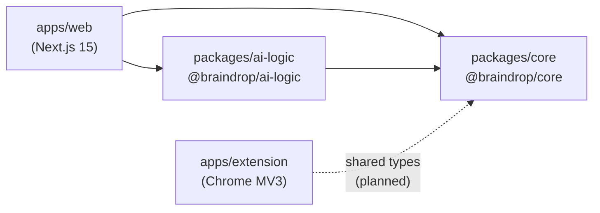

> [!NOTE]
> The extension currently uses plain JavaScript. A planned migration will add TypeScript support and directly consume `@braindrop/core` types via a bundled build step.

---

## 5. Detailed Layer Breakdown

### 5.1 Client Layer

The client layer consists of two independent frontends that share a common backend:

| Surface              | Technology          | Entry Point          | Purpose                               |
| :------------------- | :------------------ | :------------------- | :------------------------------------ |
| **Web App**          | Next.js 15 + React 19 | `apps/web/`       | Full knowledge management interface   |
| **Chrome Extension** | Vanilla JS + MV3    | `apps/extension/`   | Web clipping and quick note capture   |

**Web App Routes:**

| Route          | Component              | Layout Group    | Description                                    |
| :------------- | :--------------------- | :-------------- | :--------------------------------------------- |
| `/`            | `page.tsx`             | Root            | Landing page — hero, feature cards, architecture|
| `/notes`       | `(dashboard)/notes`    | Dashboard       | Note list + Tiptap editor + AI action sidebar  |
| `/graph`       | `(dashboard)/graph`    | Dashboard       | React Flow knowledge graph visualization       |
| `/flashcards`  | `(dashboard)/flashcards`| Dashboard      | Flashcard study mode with spaced repetition     |
| `/dashboard`   | `(dashboard)/dashboard`| Dashboard       | Telemetry dashboard — AI operation analytics   |
| `/api/clips`   | `api/clips/route.ts`   | API             | REST endpoint for extension clip sync          |

**Persistent UI Elements (Root Layout):**

| Element              | Position       | Purpose                                         |
| :------------------- | :------------- | :----------------------------------------------- |
| **Navbar**           | Fixed top       | Navigation links, Nano status badge, Demo Mode toggle |
| **TelemetryHUD**     | Fixed bottom    | Real-time counters: On-Device / Cloud / Simulated ops, bytes kept local |

### 5.2 Application Layer

The application layer houses all business logic, split across two shared packages:

#### `@braindrop/core` — Shared Foundations

| Module              | Exports                                                           |
| :------------------ | :---------------------------------------------------------------- |
| `types/index.ts`    | `Note`, `Clip`, `Tag`, `FlashCard`, `GraphNode`, `GraphEdge`, `KnowledgeGraph`, `TelemetryRecord`, `TelemetryStats`, `AITaskType`, `AITaskRequest`, `AITaskResult`, `InferenceStrategy`, `HybridConfig`, `UserSettings` |
| `utils/sanitizer.ts`| `sanitize()`, `containsPII()`, `SanitizeResult`, `Redaction`      |
| `utils/formatters.ts`| `timeAgo()`, `truncate()`, `stripHtml()`, `stringToColor()`, `readingTime()`, `wordCount()`, `formatBytes()` |

#### `@braindrop/ai-logic` — Hybrid AI Engine

| Module              | Exports                                                           |
| :------------------ | :---------------------------------------------------------------- |
| `detector.ts`       | `detectOnDeviceAI()`, `isNanoReady()`, `NanoStatus`, `DeviceCapability` |
| `router.ts`         | `executeTask()`, `getTelemetryLog()`, `getTelemetryStats()`, `clearTelemetry()` |
| `simulation.ts`     | `simulateNano()` — deterministic mock responses                    |
| `prompts.ts`        | `PROMPTS` template object, `fillPrompt()` interpolation function   |
| `tasks/tagger.ts`   | `autoTag(text)` → `string[]`                                      |
| `tasks/summarizer.ts`| `summarize(text)`, `simplify(text)`, `expand(text)`              |
| `tasks/synthesizer.ts`| `synthesize(noteTexts[])` → research brief                      |
| `tasks/flashcard.ts`| `generateFlashcards(text, noteId)` → `FlashCard[]`                |
| `tasks/linker.ts`   | `findRelatedNotes(source, candidates[])` → scored matches          |
| `tasks/search.ts`   | `semanticSearch(query, notes[])` → `SearchResult[]`               |

### 5.3 Data Layer

| Service              | Provider         | Purpose                                       |
| :------------------- | :--------------- | :--------------------------------------------- |
| **Cloud Firestore**  | Firebase          | Primary data store for notes, flashcards, telemetry |
| **chrome.storage.local** | Chrome APIs  | Extension-local clip buffer (max 100 clips)    |
| **Zustand stores**   | Client memory     | Reactive UI state (see §9)                     |

### 5.4 AI Provider Layer

| Provider             | Model             | Access Method                          | Use Cases                                  |
| :------------------- | :---------------- | :------------------------------------- | :----------------------------------------- |
| **On-Device**        | Gemini Nano 4     | `window.ai.languageModel` Prompt API   | Tag, summarize, simplify, link, search     |
| **Cloud**            | Gemini 3.8 Flash  | Firebase AI Logic SDK                  | Synthesize, flashcard, expand, translate   |
| **Simulation**       | Mock engine        | `simulateNano()` (deterministic)      | Demo mode for non-Chrome browsers          |

---

## 6. Hybrid AI Inference Architecture

The Hybrid AI Inference Architecture is the core differentiator of BrainDrop AI. It enables privacy-preserving AI operations by routing tasks between on-device and cloud models based on task type, device capability, and user preference.

### 6.1 Inference Strategy Matrix

| Strategy              | Description                                                  |
| :-------------------- | :----------------------------------------------------------- |
| `PREFER_ON_DEVICE`    | Default. Routes privacy tasks to Nano, complex tasks to cloud. Falls back to simulation if Nano is unavailable. |
| `ONLY_ON_DEVICE`      | Forces all tasks through Nano. Returns simulated results if Nano is unavailable. |
| `ONLY_CLOUD`          | Forces all tasks through Gemini 3.8 Flash. PII is sanitized before every request. |
| `AUTO`                | Same as `PREFER_ON_DEVICE` in current implementation.        |

### 6.2 Task Routing Table

| AI Task       | `AITaskType`  | Default Target  | Prompt Template     | Input → Output                                |
| :------------ | :------------ | :-------------- | :------------------ | :--------------------------------------------- |
| Auto-Tag      | `tag`         | 🟢 On-Device    | `PROMPTS.TAG`       | Note text → JSON array of tag strings          |
| Summarize     | `summarize`   | 🟢 On-Device    | `PROMPTS.SUMMARIZE` | Note text → 2-3 sentence summary              |
| Simplify      | `simplify`    | 🟢 On-Device    | `PROMPTS.SIMPLIFY`  | Complex text → simplified version              |
| Smart Link    | `link`        | 🟢 On-Device    | _(direct input)_    | Note pair → `{related, reason}` JSON          |
| Semantic Search| `search`     | 🟢 On-Device    | _(direct input)_    | Query + notes → `SearchResult[]` ranked        |
| Synthesize    | `synthesize`  | 🔵 Cloud        | `PROMPTS.SYNTHESIZE`| Multi-note input → research brief (Markdown)   |
| Flashcards    | `flashcard`   | 🔵 Cloud        | `PROMPTS.FLASHCARD` | Note text → JSON array of Q&A pairs           |
| Expand        | `expand`      | 🔵 Cloud        | `PROMPTS.EXPAND`    | Brief note → detailed paragraph                |
| Translate     | `translate`   | 🔵 Cloud        | `PROMPTS.TRANSLATE` | Text + target language → translated text       |

### 6.3 Hybrid Router Flow

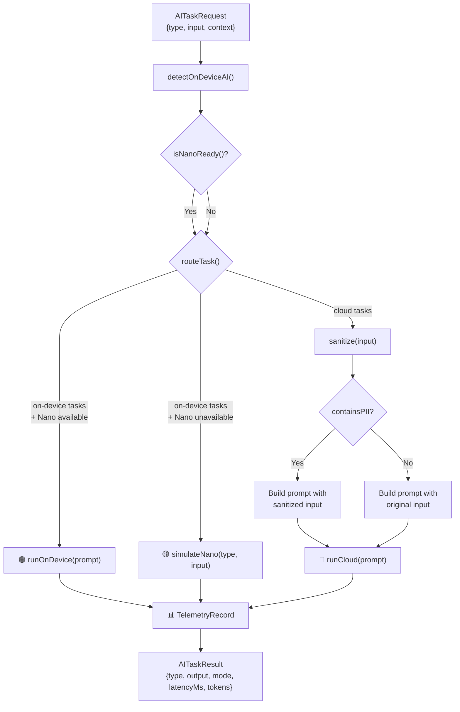

### 6.4 On-Device Execution Path

The on-device path uses the Chrome built-in `window.ai.languageModel` Prompt API (available in Chrome 138+):

```typescript
// From packages/ai-logic/src/router.ts
async function runOnDevice(prompt: string): Promise<{ output: string; latencyMs: number }> {
  const start = performance.now();
  try {
    const session = await (window as any).ai.languageModel.create();
    const output = await session.prompt(prompt);
    session.destroy();
    return { output: output.trim(), latencyMs: Math.round(performance.now() - start) };
  } catch (error) {
    throw new Error(`On-device inference failed: ${error}`);
  }
}
```

### 6.5 Device Capability Detection

Before routing, the system probes the browser for AI capabilities:

```typescript
// From packages/ai-logic/src/detector.ts
export type NanoStatus = "available" | "downloadable" | "unavailable" | "unknown";

export interface DeviceCapability {
  nanoStatus: NanoStatus;
  browserName: string;
  browserVersion: string;
  supportsWebGPU: boolean;
  timestamp: Date;
}
```

| `NanoStatus`    | Meaning                                              | Router Behavior               |
| :-------------- | :--------------------------------------------------- | :---------------------------- |
| `available`     | Gemini Nano model is ready for inference              | Routes on-device tasks to Nano |
| `downloadable`  | Model can be downloaded but isn't ready yet           | Falls back to simulation       |
| `unavailable`   | Browser doesn't support `window.ai`                  | Falls back to simulation       |
| `unknown`       | Detection hasn't run yet (SSR)                        | Falls back to simulation       |

### 6.6 Simulation Mode

For non-Chrome browsers or when Nano isn't available, deterministic handlers produce realistic responses:

```typescript
// From packages/ai-logic/src/simulation.ts
const HANDLERS: Record<string, (input: string) => string> = {
  tag: (input) => {
    const keywords = input.toLowerCase().split(/\s+/).filter(w => w.length > 4);
    const tags = [...new Set(keywords.slice(0, 5))];
    return JSON.stringify(tags.length > 0 ? tags : ["general", "research"]);
  },
  summarize: (input) => {
    const sentences = input.split(/[.!?]+/).filter(Boolean);
    const summary = sentences.slice(0, 2).join(". ").trim();
    return summary ? summary + "." : "This note covers key research findings and insights.";
  },
  // ... simplify, link, search handlers
};
```

> [!TIP]
> Simulation latencies are randomized between 35–120ms to mimic realistic on-device inference timing without being instantaneous.

---

## 7. Data Flow Diagrams

### 7.1 Clip Flow — Extension to Web App

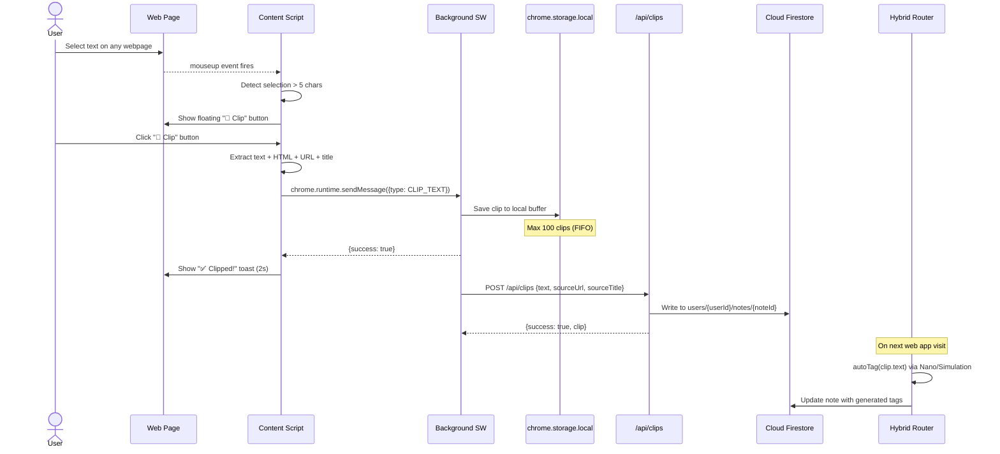

### 7.2 Note Editing Flow — AI Actions

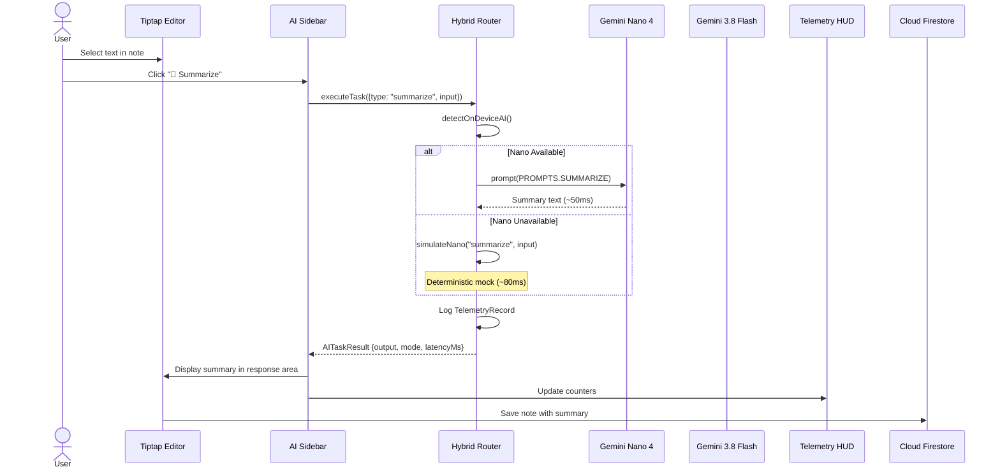

### 7.3 Synthesis Flow — Multi-Note Cloud AI

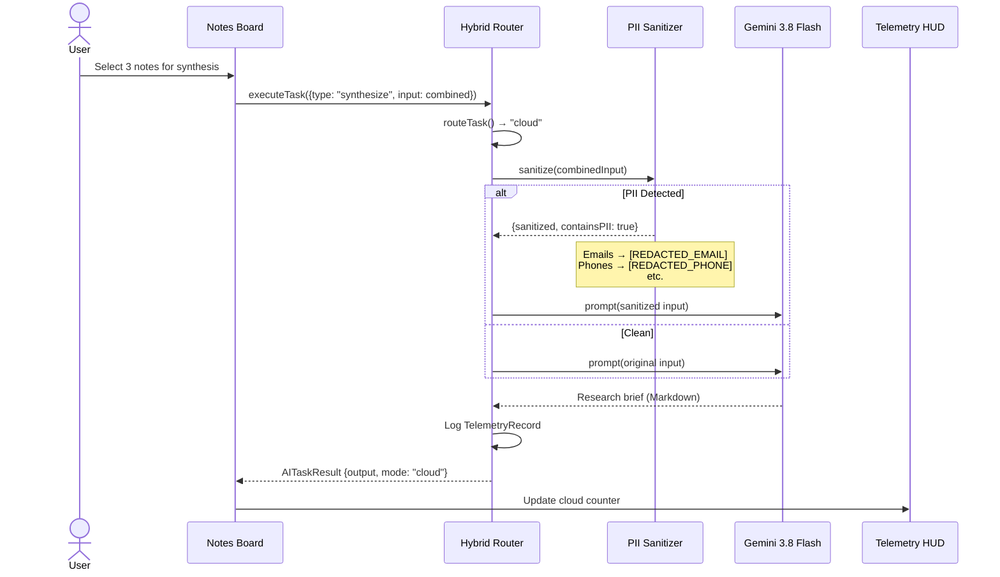

### 7.4 Knowledge Graph Flow

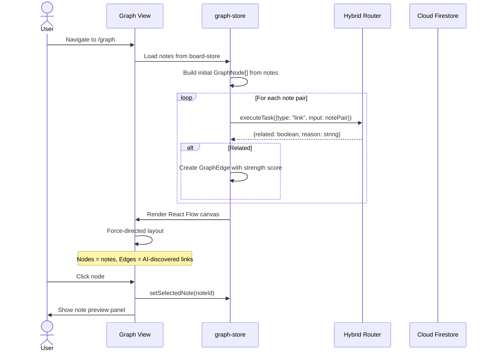

---

## 8. API Route Architecture

### 8.1 Clips API — `/api/clips`

The clips API is the bridge between the Chrome Extension and Cloud Firestore.

| Method | Endpoint       | Request Body                                           | Response                                    | Status Codes     |
| :----- | :------------- | :----------------------------------------------------- | :------------------------------------------ | :--------------- |
| `POST` | `/api/clips`   | `{ text, sourceUrl, sourceTitle, tags? }`              | `{ success: true, clip: Clip }`             | `201`, `500`     |
| `GET`  | `/api/clips`   | _(none)_                                               | `{ clips: Clip[], total: number }`          | `200`            |

```typescript
// From apps/web/src/app/api/clips/route.ts
export async function POST(request: NextRequest) {
  try {
    const body = await request.json();
    const clip = {
      id: crypto.randomUUID(),
      text: body.text,
      sourceUrl: body.sourceUrl,
      sourceTitle: body.sourceTitle || "Untitled",
      tags: body.tags || [],
      createdAt: new Date().toISOString(),
    };
    // TODO: Save to Firestore via @braindrop/core
    return NextResponse.json({ success: true, clip }, { status: 201 });
  } catch (error) {
    return NextResponse.json(
      { success: false, error: "Failed to create clip" },
      { status: 500 }
    );
  }
}
```

### 8.2 Future API Routes (Planned)

| Route                  | Method | Purpose                                     |
| :--------------------- | :----- | :------------------------------------------ |
| `/api/notes`           | CRUD   | Note management with Firestore persistence  |
| `/api/flashcards`      | CRUD   | Flashcard CRUD + spaced repetition updates  |
| `/api/graph`           | GET    | Fetch pre-computed knowledge graph edges    |
| `/api/ai/synthesize`   | POST   | Server-side synthesis for long documents    |
| `/api/telemetry`       | POST   | Batch telemetry record persistence          |

---

## 9. State Management Architecture

BrainDrop AI uses **Zustand 5** for client-side state management. Each domain has a dedicated store with clear responsibilities and no cross-store coupling.

### 9.1 Store Overview

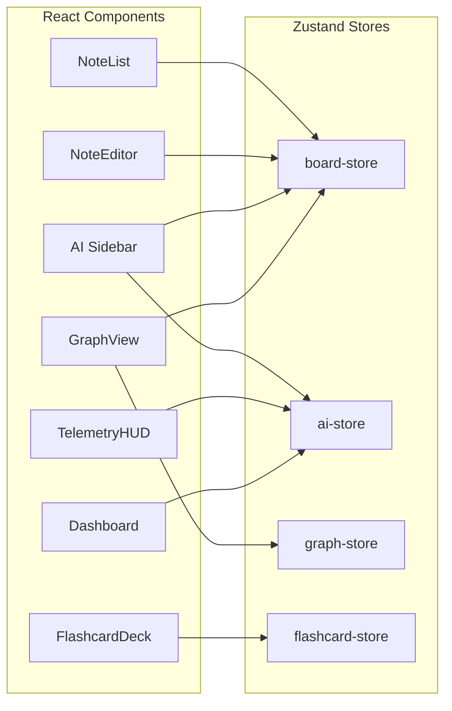

### 9.2 Store Specifications

#### `board-store` — Notes & Navigation State

```typescript
interface BoardStore {
  // Data
  notes: Note[];
  selectedNoteId: string | null;
  searchQuery: string;
  activeTagFilter: string | null;
  sortBy: "updatedAt" | "createdAt" | "title";

  // Actions
  setNotes: (notes: Note[]) => void;
  addNote: (note: Note) => void;
  updateNote: (id: string, updates: Partial<Note>) => void;
  deleteNote: (id: string) => void;
  setSelectedNote: (id: string | null) => void;
  setSearchQuery: (query: string) => void;
  setActiveTagFilter: (tag: string | null) => void;
  setSortBy: (sort: "updatedAt" | "createdAt" | "title") => void;

  // Computed (via selectors)
  filteredNotes: () => Note[];
  allTags: () => Tag[];
}
```

#### `ai-store` — AI Operations & Telemetry State

```typescript
interface AIStore {
  // Device capability
  deviceCapability: DeviceCapability | null;
  isDetecting: boolean;

  // Task queue
  activeTask: AITaskRequest | null;
  taskResult: AITaskResult | null;
  isProcessing: boolean;
  error: string | null;

  // Telemetry
  telemetryStats: TelemetryStats;
  telemetryLog: TelemetryRecord[];

  // Config
  config: HybridConfig;

  // Actions
  detectCapability: () => Promise<void>;
  runTask: (request: AITaskRequest) => Promise<AITaskResult>;
  setConfig: (config: Partial<HybridConfig>) => void;
  refreshTelemetry: () => void;
  clearTelemetry: () => void;
}
```

#### `graph-store` — Knowledge Graph State

```typescript
interface GraphStore {
  // Data
  nodes: GraphNode[];
  edges: GraphEdge[];
  selectedNodeId: string | null;

  // Layout
  layoutType: "force" | "hierarchical" | "radial";
  zoom: number;

  // Actions
  buildGraph: (notes: Note[]) => void;
  addEdge: (edge: GraphEdge) => void;
  removeEdge: (edgeId: string) => void;
  setSelectedNode: (id: string | null) => void;
  setLayoutType: (type: "force" | "hierarchical" | "radial") => void;
}
```

#### `flashcard-store` — Study Session State

```typescript
interface FlashcardStore {
  // Data
  cards: FlashCard[];
  currentIndex: number;
  isFlipped: boolean;

  // Session
  sessionCorrect: number;
  sessionIncorrect: number;
  sessionStarted: Date | null;

  // Actions
  setCards: (cards: FlashCard[]) => void;
  generateFromNote: (noteId: string, text: string) => Promise<void>;
  flipCard: () => void;
  markCorrect: () => void;
  markIncorrect: () => void;
  nextCard: () => void;
  resetSession: () => void;
}
```

---

## 10. Chrome Extension Architecture

### 10.1 MV3 Component Overview

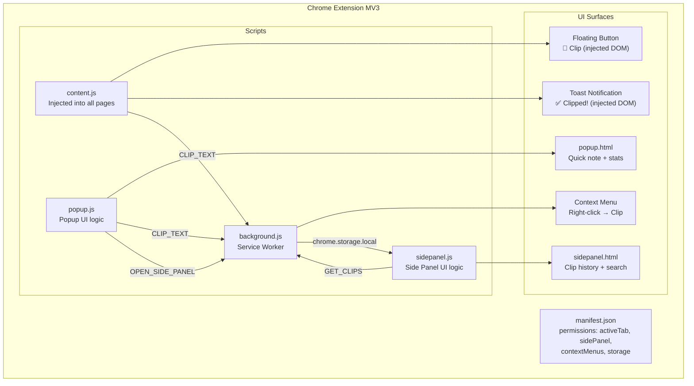

### 10.2 Manifest V3 Permissions

| Permission       | Purpose                                              |
| :--------------- | :--------------------------------------------------- |
| `activeTab`      | Access the current tab's URL and title for clip metadata |
| `sidePanel`      | Enable the side panel UI for clip history browsing   |
| `contextMenus`   | Add "Clip to BrainDrop AI" to the right-click menu   |
| `storage`        | Store clips locally in `chrome.storage.local`         |

### 10.3 Message Protocol

| Message Type       | Sender           | Handler          | Payload                                        | Response                  |
| :----------------- | :--------------- | :--------------- | :--------------------------------------------- | :------------------------ |
| `CLIP_TEXT`        | Content Script    | Background SW    | `{text, selectedHtml, sourceUrl, sourceTitle}` | `{success, clip}`         |
| `CLIP_TEXT`        | Popup Script      | Background SW    | `{text, sourceUrl: "", sourceTitle: "Quick Note"}` | `{success, clip}`     |
| `GET_CLIPS`       | Side Panel        | Background SW    | _(none)_                                       | `{clips: Clip[]}`         |
| `OPEN_SIDE_PANEL` | Popup Script      | Background SW    | _(none)_                                       | `{success: true}`         |

### 10.4 Content Script Behavior

The content script implements a non-intrusive floating UI pattern:

1. **Selection Detection** — `mouseup` listener checks if selected text length > 5 characters
2. **Button Positioning** — Floating "🧠 Clip" button appears above the selection using `getBoundingClientRect()`
3. **Clip Capture** — On click, extracts plain text + HTML + page URL + page title
4. **Message Dispatch** — Sends `CLIP_TEXT` message to background service worker
5. **Feedback** — Shows a toast notification for 2 seconds, then auto-dismisses
6. **Cleanup** — Button hides on `mousedown` elsewhere or scroll events

> [!WARNING]
> The content script injects DOM elements with `z-index: 999999`. This may conflict with pages that use similarly high z-index values. The injected elements use unique IDs (`#braindrop-clip-button`) to avoid CSS collisions.

---

## 11. Data Model & Firestore Schema

### 11.1 Entity Relationship Diagram

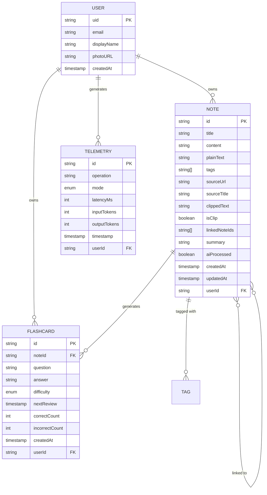

### 11.2 Firestore Collection Paths

| Collection Path                          | Document ID     | Description                              |
| :--------------------------------------- | :-------------- | :--------------------------------------- |
| `users/{userId}/notes/{noteId}`          | Auto-generated  | Notes with rich content, tags, links     |
| `users/{userId}/flashcards/{cardId}`     | Auto-generated  | Q&A cards with spaced repetition state   |
| `users/{userId}/telemetry/{logId}`       | Auto-generated  | AI operation telemetry records           |

### 11.3 Core Type Definitions

```typescript
// From packages/core/src/types/index.ts

export interface Note {
  id: string;
  title: string;
  content: string;         // Rich text (HTML from Tiptap)
  plainText: string;       // Stripped text for AI processing
  tags: string[];
  sourceUrl?: string;      // Origin URL (if clipped)
  sourceTitle?: string;    // Origin page title
  clippedText?: string;    // Original clipped text
  isClip: boolean;         // True if created via extension
  linkedNoteIds: string[]; // Bidirectional links
  summary?: string;        // AI-generated summary
  aiProcessed: boolean;    // True if AI has processed this note
  createdAt: Date;
  updatedAt: Date;
  userId: string;
}

export interface FlashCard {
  id: string;
  noteId: string;
  question: string;
  answer: string;
  difficulty: "easy" | "medium" | "hard";
  nextReview: Date;        // Spaced repetition scheduling
  correctCount: number;
  incorrectCount: number;
  createdAt: Date;
  userId: string;
}

export type AITaskType =
  | "tag" | "summarize" | "simplify" | "expand"
  | "link" | "synthesize" | "flashcard" | "translate" | "search";

export type InferenceStrategy =
  | "PREFER_ON_DEVICE" | "ONLY_ON_DEVICE" | "ONLY_CLOUD" | "AUTO";
```

---

## 12. Security Architecture

### 12.1 Security Layers

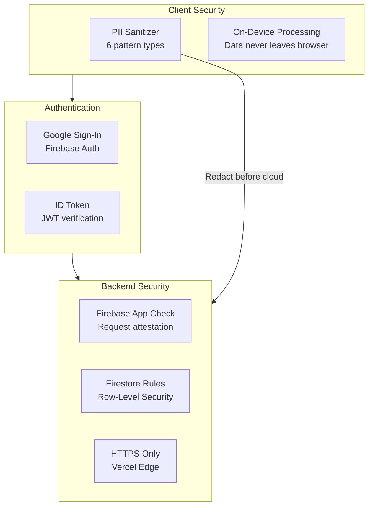

### 12.2 PII Sanitization Engine

The PII sanitizer runs **before every cloud inference request**, ensuring sensitive data never reaches external servers.

| PII Pattern      | Regex Target                              | Replacement           | Example                                     |
| :--------------- | :---------------------------------------- | :-------------------- | :------------------------------------------ |
| **Email**        | `user@domain.com`                         | `[REDACTED_EMAIL]`    | `john@gmail.com` → `[REDACTED_EMAIL]`       |
| **Phone**        | `+62`, `62`, or `0` prefix + 8-12 digits  | `[REDACTED_PHONE]`    | `+6281234567890` → `[REDACTED_PHONE]`       |
| **Credit Card**  | 4 groups of 4 digits                      | `[REDACTED_CC]`       | `4111-2222-3333-4444` → `[REDACTED_CC]`     |
| **NIK (ID)**     | 16-digit number                           | `[REDACTED_ID]`       | `3201234567890001` → `[REDACTED_ID]`        |
| **IP Address**   | IPv4 dotted notation                      | `[REDACTED_IP]`       | `192.168.1.1` → `[REDACTED_IP]`            |
| **API Key**      | `api_key=`, `token=`, `secret=` + 20+ chars | `[REDACTED_SECRET]` | `api_key=sk-abc123...` → `[REDACTED_SECRET]`|

```typescript
// Usage in the Hybrid Router (packages/ai-logic/src/router.ts)
if (mode === "cloud") {
  const sanitized = sanitize(request.input);
  const cloudPrompt = sanitized.containsPII
    ? buildPrompt({ ...request, input: sanitized.sanitized })
    : prompt;
  const result = await runCloud(cloudPrompt);
}
```

### 12.3 Firestore Security Rules (Planned)

```javascript
rules_version = '2';
service cloud.firestore {
  match /databases/{database}/documents {
    // Users can only access their own data
    match /users/{userId}/{document=**} {
      allow read, write: if request.auth != null && request.auth.uid == userId;
    }

    // Deny all other access
    match /{document=**} {
      allow read, write: if false;
    }
  }
}
```

### 12.4 Security Principles Summary

| Principle                     | Implementation                                             |
| :---------------------------- | :--------------------------------------------------------- |
| **Data Minimization**         | On-device inference for privacy-sensitive tasks             |
| **PII Protection**            | Auto-redaction before cloud requests                       |
| **Authentication**            | Firebase Auth with Google Sign-In                          |
| **Authorization**             | Firestore RLS — users access only their own documents      |
| **Transport Security**        | HTTPS everywhere (Vercel Edge, Firebase)                   |
| **Request Attestation**       | Firebase App Check prevents API abuse                      |
| **Extension Isolation**       | MV3 service worker, minimal permissions, no `<all_urls>` host permission for network |

---

## 13. Deployment Architecture

### 13.1 Infrastructure Topology

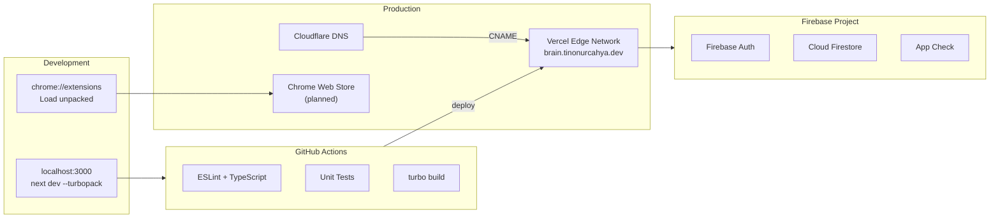

### 13.2 Build Pipeline

| Stage              | Tool                | Command                    | Purpose                          |
| :----------------- | :------------------ | :------------------------- | :------------------------------- |
| **Install**        | npm                 | `npm install`              | Install all workspace dependencies|
| **Lint**           | ESLint              | `turbo lint`               | Code quality checks               |
| **Type Check**     | TypeScript          | `turbo type-check`         | Static type verification          |
| **Build Packages** | Turborepo           | `turbo build`              | Build `core` → `ai-logic` → `web`|
| **Test**           | Vitest (planned)    | `turbo test`               | Unit + integration tests          |
| **Deploy Web**     | Vercel              | _(automatic on push)_      | Deploy Next.js to edge network   |
| **Deploy Ext**     | Manual / CWS CLI    | _(planned)_                | Upload to Chrome Web Store       |

### 13.3 Environment Configuration

| Variable                             | Environment | Purpose                              |
| :----------------------------------- | :---------- | :----------------------------------- |
| `NEXT_PUBLIC_FIREBASE_API_KEY`       | All         | Firebase project API key             |
| `NEXT_PUBLIC_FIREBASE_AUTH_DOMAIN`   | All         | Firebase Auth domain                 |
| `NEXT_PUBLIC_FIREBASE_PROJECT_ID`    | All         | Firebase project identifier          |
| `NEXT_PUBLIC_FIREBASE_APP_ID`        | All         | Firebase app identifier              |
| `FIREBASE_APP_CHECK_KEY`            | Production  | App Check reCAPTCHA site key         |
| `VERCEL_URL`                        | Production  | Vercel deployment URL                |

---

## 14. Performance Architecture

### 14.1 Performance Budget

| Metric                     | Target            | Strategy                                       |
| :------------------------- | :---------------- | :--------------------------------------------- |
| **First Contentful Paint** | < 1.2s            | SSR via Next.js App Router, code splitting      |
| **Largest Contentful Paint**| < 2.0s           | Image optimization (Sharp), font subsetting     |
| **Time to Interactive**    | < 2.5s            | Lazy load non-critical routes, streaming SSR    |
| **On-Device AI Latency**   | < 200ms           | Gemini Nano 4 prompt; session reuse             |
| **Cloud AI Latency**       | < 1500ms          | Gemini 3.8 Flash; prompt length optimization    |
| **Bundle Size (JS)**       | < 250KB gzipped   | Tree shaking, dynamic imports, Turbopack        |
| **Extension Load**         | < 50ms            | Minimal content script, lazy DOM injection      |

### 14.2 Optimization Strategies

| Strategy                          | Implementation                                              |
| :-------------------------------- | :---------------------------------------------------------- |
| **Route-Based Code Splitting**    | Next.js App Router automatically splits `(dashboard)` routes|
| **Streaming SSR**                 | React 19 Suspense boundaries for progressive rendering      |
| **Image Optimization**            | Next.js `<Image>` with Sharp, WebP/AVIF auto-conversion     |
| **Turbopack (Dev)**               | `next dev --turbopack` for 10x faster HMR                   |
| **Turborepo Caching**             | Remote cache for CI builds; skip unchanged packages          |
| **AI Session Management**         | Create Nano session once, destroy after use to free memory   |
| **Prompt Length Limits**          | `maxOnDeviceTokens: 1024` — truncate input for Nano         |
| **Debounced Search**              | Semantic search debounced to avoid excessive AI calls        |
| **Lazy Graph Rendering**          | React Flow renders visible nodes only; virtualized edge list |
| **Extension Storage Capping**     | FIFO buffer at 100 clips in `chrome.storage.local`           |

### 14.3 Telemetry-Driven Performance Monitoring

Every AI operation is tracked via `TelemetryRecord`:

```typescript
export interface TelemetryRecord {
  id: string;
  operation: string;           // AITaskType
  mode: "on-device" | "cloud" | "simulated";
  latencyMs: number;           // Measured via performance.now()
  inputTokens: number;         // Estimated: Math.ceil(input.length / 4)
  outputTokens?: number;       // Estimated: Math.ceil(output.length / 4)
  timestamp: Date;
  userId: string;
}
```

Aggregated statistics power the Dashboard and TelemetryHUD:

```typescript
export interface TelemetryStats {
  totalOnDevice: number;       // Count of Nano executions
  totalCloud: number;          // Count of cloud executions
  totalSimulated: number;      // Count of simulation executions
  avgOnDeviceLatency: number;  // Average Nano latency (ms)
  avgCloudLatency: number;     // Average cloud latency (ms)
  bytesKeptLocal: number;      // Total bytes processed on-device
}
```

---

## 15. Error Handling & Fallback Strategy

### 15.1 Error Cascade Model

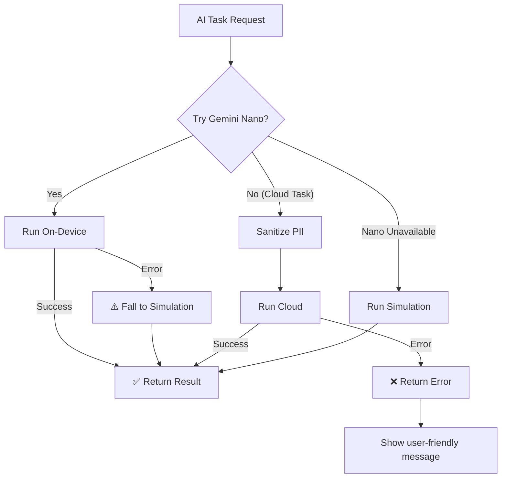

### 15.2 Error Categories & Handling

| Error Category                | Source                  | Handling Strategy                              | User Impact                    |
| :---------------------------- | :---------------------- | :--------------------------------------------- | :----------------------------- |
| **Nano Unavailable**          | `detector.ts`           | Route to simulation mode automatically         | Seamless — labeled "Simulated" |
| **Nano Session Failure**      | `router.ts`             | Catch, destroy session, return simulation result| Seamless with console warning  |
| **Cloud API Error**           | `router.ts`             | Catch, return error message to UI               | Error toast with retry option  |
| **PII Sanitization Failure**  | `sanitizer.ts`          | Default to blocking the cloud request           | Error message, suggest on-device|
| **Extension Message Failure** | `content.js`            | Catch in callback, show error toast             | "Failed to clip" notification  |
| **Firestore Write Failure**   | `route.ts`              | Return 500 with error message                   | Clip saved locally only        |
| **Invalid AI Output (JSON)**  | Task files              | Fallback parser (CSV split, default response)   | Degraded but functional output |

### 15.3 JSON Parse Fallback Pattern

AI task handlers implement a consistent fallback pattern when the model returns non-JSON output:

```typescript
// Pattern used across tagger.ts, flashcard.ts, search.ts, linker.ts
export async function autoTag(text: string): Promise<string[]> {
  const result: AITaskResult = await executeTask({ type: "tag", input: text });
  try {
    return JSON.parse(result.output);             // Happy path: valid JSON array
  } catch {
    return result.output                           // Fallback: split comma-separated
      .split(",")
      .map((t) => t.trim().toLowerCase());
  }
}
```

### 15.4 Extension Resilience

| Failure Scenario                     | Behavior                                          |
| :----------------------------------- | :------------------------------------------------ |
| Background SW terminated (MV3 idle)  | Chrome auto-restarts on next message               |
| `chrome.storage.local` full          | FIFO — oldest clips dropped beyond 100-clip limit |
| API endpoint unreachable             | Clips remain in local storage for later sync       |
| Content script injection blocked     | Context menu ("Clip to BrainDrop AI") still works  |
| `sendResponse` async race           | `return true` keeps message channel open           |

> [!CAUTION]
> MV3 service workers can be terminated by Chrome at any time. All state in `background.js` must be persisted to `chrome.storage.local` or reconstructed on wake. Never rely on in-memory state persisting across service worker lifetimes.

---

## 16. Related Documents

| Document                  | Path                          | Description                              |
| :------------------------ | :---------------------------- | :--------------------------------------- |
| Project README            | `./README.md`                 | Quick start, feature overview, demo link |
| API Documentation         | `./docs/API.md`                | Detailed API endpoint specifications     |
| Data Flow Specification   | `./docs/DATA_FLOW.md`          | End-to-end data flow documentation       |
| Testing Strategy          | `./docs/TESTING.md`            | Test pyramid, coverage targets           |
| Deployment Guide          | `./docs/DEPLOYMENT.md`         | Vercel + Firebase deployment procedures  |
| Contributing Guide        | `./CONTRIBUTING.md`           | Code standards, PR process               |

---

> **BrainDrop AI** — _Capture anything. Forget nothing._
>
> Built with ❤️ by [Tino Nurcahya](https://tinonurcahya.dev) for [#BuildHybridAI 2026](https://firebasehybridaihackathon.devpost.com/)
>
> Firebase AI Logic • Gemini Nano 4 • Gemini 3.8 Flash


