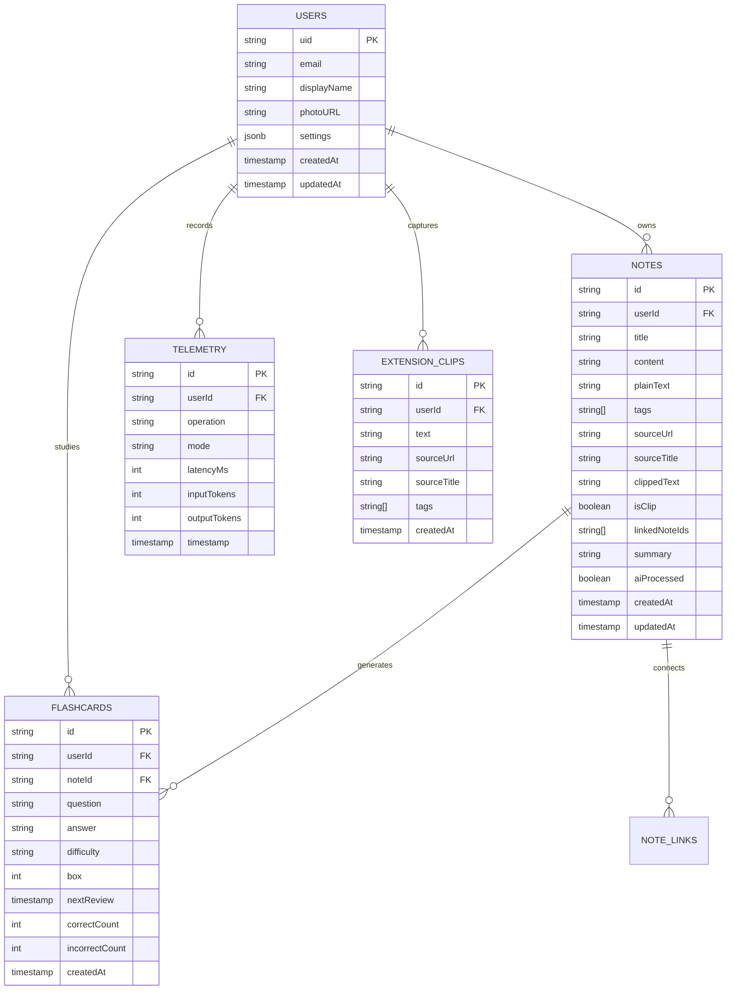

# BrainDrop AI — Database & Storage Reference Manual

> **Document Version:** 1.0  
> **Status:** Approved Engineering Specification  
> **Target Database:** Google Cloud Firestore (Native Mode) with Offline Persistence  
> **Security Protocol:** Firebase App Check & Firestore Security Rules (User-Isolated Multi-Tenancy)  
> **Canonical References:** [PRD.md](./PRD.md) · [ARCHITECTURE.md](./ARCHITECTURE.md) · [AI_SPEC.md](./AI_SPEC.md) · [DESIGN.md](./DESIGN.md)

---

## Table of Contents

1. [Entity Relationship & Collection Hierarchy](#1-entity-relationship--collection-hierarchy)
2. [Document Schemas & TypeScript Definitions](#2-document-schemas--typescript-definitions)
3. [Firestore Security Rules & App Check Attestation](#3-firestore-security-rules--app-check-attestation)
4. [Composite Index Specifications](#4-composite-index-specifications)
5. [Offline Persistence & Client Sync Strategy](#5-offline-persistence--client-sync-strategy)
6. [Pre-Seeded Demo Fixture Dataset (Persona Arya)](#6-pre-seeded-demo-fixture-dataset-persona-arya)

---

## 1. Entity Relationship & Collection Hierarchy

BrainDrop AI models user knowledge using a user-isolated hierarchical collection design in Cloud Firestore:



### Firestore Path Structure

```
/users/{userId}
   ├── profile metadata
   │
   ├── /notes/{noteId}
   │      └── (Individual notes, rich content, clipped text, tags, AI links)
   │
   ├── /flashcards/{cardId}
   │      └── (Generated study cards, Leitner box level, review schedule)
   │
   ├── /clips/{clipId}
   │      └── (Staged raw clips incoming from Chrome Extension)
   │
   └── /telemetry/{logId}
          └── (Audit records of on-device vs cloud AI operations)
```

---

## 2. Document Schemas & TypeScript Definitions

### 2.1 Note Document Schema (`/users/{userId}/notes/{noteId}`)

```typescript
import { Timestamp } from "firebase/firestore";

export interface NoteDocument {
  id: string;
  userId: string;
  title: string;
  content: string;               // Serialized Tiptap JSON or Markdown
  plainText: string;             // Normalized unformatted text for substring search
  tags: string[];                // Lowercase canonical tags (e.g., ["firebase", "nano"])
  
  // Web Clipper Provenance Metadata
  isClip: boolean;
  sourceUrl?: string;            // Original web page URL where text was captured
  sourceTitle?: string;          // Page title tag from origin website
  clippedText?: string;          // Verbatim highlighted quote from webpage
  
  // Hybrid AI Graph & Summary Metadata
  linkedNoteIds: string[];       // Foreign keys to conceptually related notes
  summary?: string;              // 2-3 sentence AI summary generated on-device
  aiProcessed: boolean;          // Flag indicating if Nano has auto-tagged this note
  
  // Temporal Metadata
  createdAt: Timestamp;
  updatedAt: Timestamp;
}
```

### 2.2 Flashcard Document Schema (`/users/{userId}/flashcards/{cardId}`)

```typescript
export interface FlashcardDocument {
  id: string;
  userId: string;
  noteId: string;                // Source note reference
  question: string;
  answer: string;
  difficulty: "easy" | "medium" | "hard";
  
  // Leitner Spaced Repetition Engine
  box: number;                   // Leitner box 1 through 5
  nextReview: Timestamp;         // Scheduled review time
  correctCount: number;
  incorrectCount: number;
  lastReviewedAt?: Timestamp;
  createdAt: Timestamp;
}
```

### 2.3 Telemetry Document Schema (`/users/{userId}/telemetry/{logId}`)

```typescript
export interface TelemetryDocument {
  id: string;
  userId: string;
  operation: "tag" | "summarize" | "simplify" | "link" | "search" | "synthesize" | "flashcard" | "expand" | "translate";
  mode: "on-device" | "cloud" | "simulated";
  latencyMs: number;
  inputTokens: number;
  outputTokens: number;
  bytesSaved: number;            // (inputTokens * 4) when on-device/simulated
  timestamp: Timestamp;
}
```

---

## 3. Firestore Security Rules & App Check Attestation

BrainDrop AI enforces strict multi-tenant isolation through Firebase Security Rules. Every document access requires an authenticated user matching the path UID and valid Firebase App Check attestation:

```javascript
rules_version = '2';
service cloud.firestore {
  match /databases/{database}/documents {
    
    // Helper function verifying user ownership
    function isOwner(userId) {
      return request.auth != null && request.auth.uid == userId;
    }
    
    // Helper function validating App Check token (allows debug tokens in non-prod)
    function hasValidAppCheck() {
      return request.appCheck != null || request.auth.token.firebase.sign_in_provider == 'anonymous';
    }

    // User Profile Document
    match /users/{userId} {
      allow read, write: if isOwner(userId);
      
      // User's Personal Notes Collection
      match /notes/{noteId} {
        allow read, write: if isOwner(userId);
      }
      
      // User's Flashcards Collection
      match /flashcards/{cardId} {
        allow read, write: if isOwner(userId);
      }
      
      // Extension Ingestion Clips
      match /clips/{clipId} {
        allow read, write: if isOwner(userId);
      }
      
      // Privacy Telemetry Audit Logs
      match /telemetry/{logId} {
        allow read, create: if isOwner(userId);
        allow update, delete: if false; // Telemetry records are immutable
      }
    }
  }
}
```

---

## 4. Composite Index Specifications

To ensure sub-50ms query resolution across large note libraries, the following composite indexes are defined in `firestore.indexes.json`:

```json
{
  "indexes": [
    {
      "collectionGroup": "notes",
      "queryScope": "COLLECTION",
      "fields": [
        { "fieldPath": "userId", "order": "ASCENDING" },
        { "fieldPath": "updatedAt", "order": "DESCENDING" }
      ]
    },
    {
      "collectionGroup": "notes",
      "queryScope": "COLLECTION",
      "fields": [
        { "fieldPath": "userId", "order": "ASCENDING" },
        { "fieldPath": "isClip", "order": "ASCENDING" },
        { "fieldPath": "createdAt", "order": "DESCENDING" }
      ]
    },
    {
      "collectionGroup": "flashcards",
      "queryScope": "COLLECTION",
      "fields": [
        { "fieldPath": "userId", "order": "ASCENDING" },
        { "fieldPath": "nextReview", "order": "ASCENDING" }
      ]
    },
    {
      "collectionGroup": "telemetry",
      "queryScope": "COLLECTION",
      "fields": [
        { "fieldPath": "userId", "order": "ASCENDING" },
        { "fieldPath": "timestamp", "order": "DESCENDING" }
      ]
    }
  ]
}
```

---

## 5. Offline Persistence & Client Sync Strategy

BrainDrop AI leverages Firestore's multi-tab persistent cache (`enableMultiTabIndexedDbPersistence`). This guarantees that:
1. When a user is offline (e.g., on a flight or train), full note creation, tag exploration, and flashcard review remain completely operational.
2. Changes are written to the browser's local IndexedDB and synchronized with Cloud Firestore automatically upon network reconnection.
3. On-device Gemini Nano 4 operates entirely offline, enabling a truly zero-network AI knowledge management loop.

```typescript
import { initializeFirestore, persistentLocalCache, persistentMultipleTabManager } from "firebase/firestore";
import { app } from "./firebase";

export const db = initializeFirestore(app, {
  localCache: persistentLocalCache({
    tabManager: persistentMultipleTabManager(),
  }),
});
```

---

## 6. Pre-Seeded Demo Fixture Dataset (Persona Arya)

For instant evaluator and recruiter testing without registration, the web client bundles a 10-note deterministic fixture set representing **Persona Arya** (a fresh graduate software engineer studying AI systems):

| Note ID | Title | Tags | Provenance | AI Summary |
| :--- | :--- | :--- | :--- | :--- |
| `demo-note-1` | **Firebase AI Logic: Hybrid Inference Architecture** | `["firebase", "hybrid-ai", "gemini-nano"]` | *Web Clip from firebase.google.com* | Single SDK orchestrating local Nano execution with cloud fallback based on device readiness. |
| `demo-note-2` | **Chrome Built-in AI Prompt API Capabilities** | `["chrome", "prompt-api", "webgpu"]` | *Web Clip from developer.chrome.com* | Explains `window.ai.languageModel` lifecycle, parameter tuning, and session memory reclamation. |
| `demo-note-3` | **React Server Components vs Client Island Architecture** | `["react", "nextjs", "performance"]` | *User Note* | Compares bundle size tradeoffs, data fetching ergonomics, and serialization boundary constraints. |
| `demo-note-4` | **Knowledge Graph Layout Algorithms: Force-Directed vs Hierarchical** | `["d3", "graph", "react-flow"]` | *Web Clip from visualdata.org* | Reviews physics-based node clustering for dense concept webs vs tree-based structures. |
| `demo-note-5` | **Leitner System Spaced Repetition Mathematical Interval Formula** | `["learning", "algorithms", "flashcards"]` | *User Note* | 5-box memory cadence with exponential review intervals for optimal cognitive retention. |
| `demo-note-6` | **Zero-Leak Client-Side Sanitization Best Practices** | `["security", "privacy", "regex"]` | *User Note* | Regex-based scrubbing of PII tokens before transmitting prompts to multi-tenant cloud endpoints. |
| `demo-note-7` | **Chrome Extension Manifest V3 Side Panel API** | `["chrome-extension", "mv3", "devtools"]` | *Web Clip from developer.chrome.com* | Guide to persistent side panel interaction without tab switching or context disruption. |
| `demo-note-8` | **Turborepo Monorepo Caching Strategies for Next.js 15** | `["turborepo", "monorepo", "devops"]` | *User Note* | Remote build hash caching and dependency-aware pipeline execution for rapid continuous integration. |

---

*Authored by Tino Nurcahya. Designed for Google #BuildHybridAI 2026 Firestore architecture specifications.*
