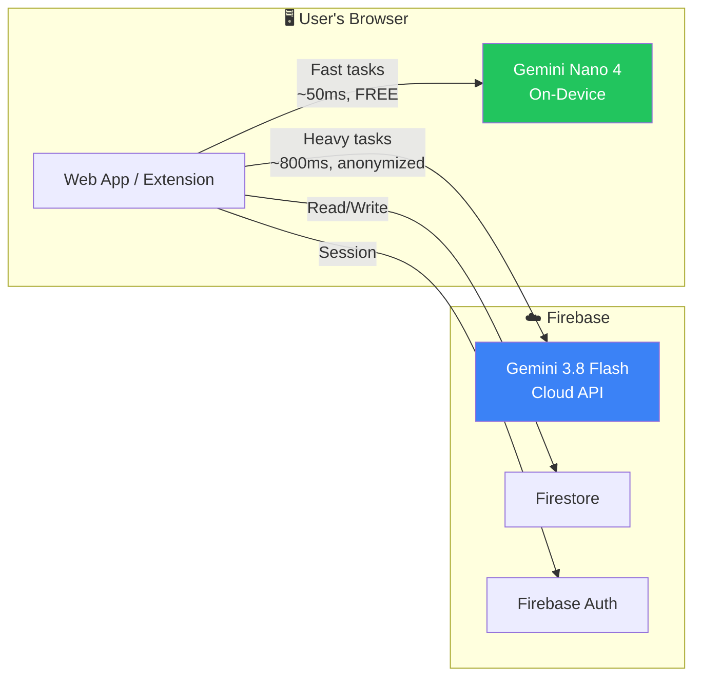
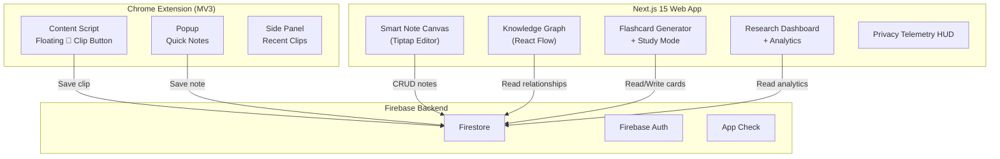
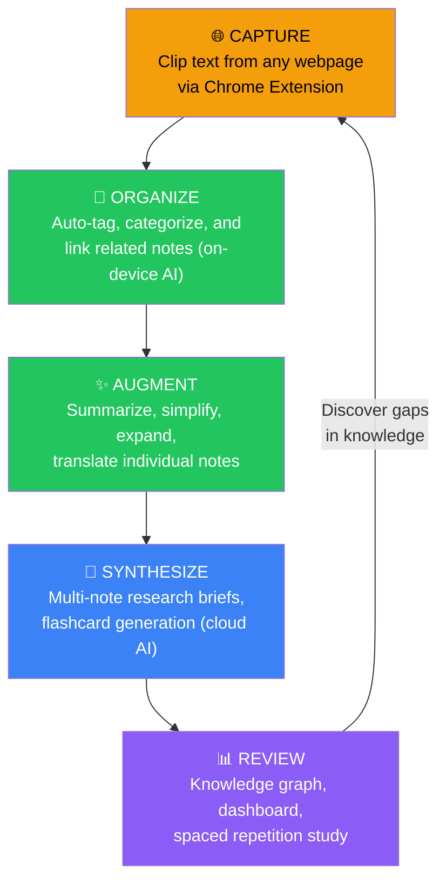
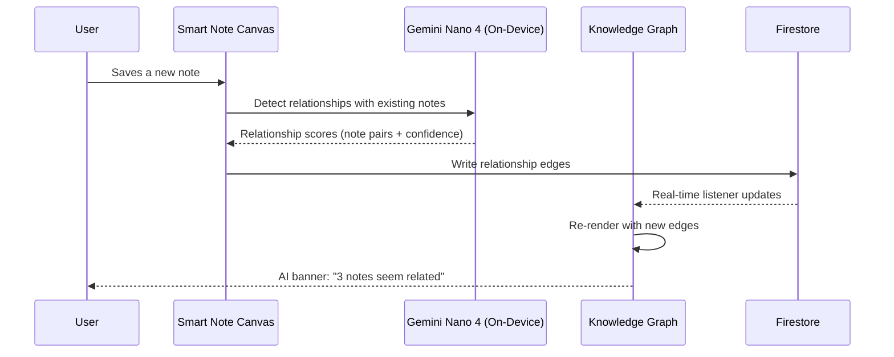
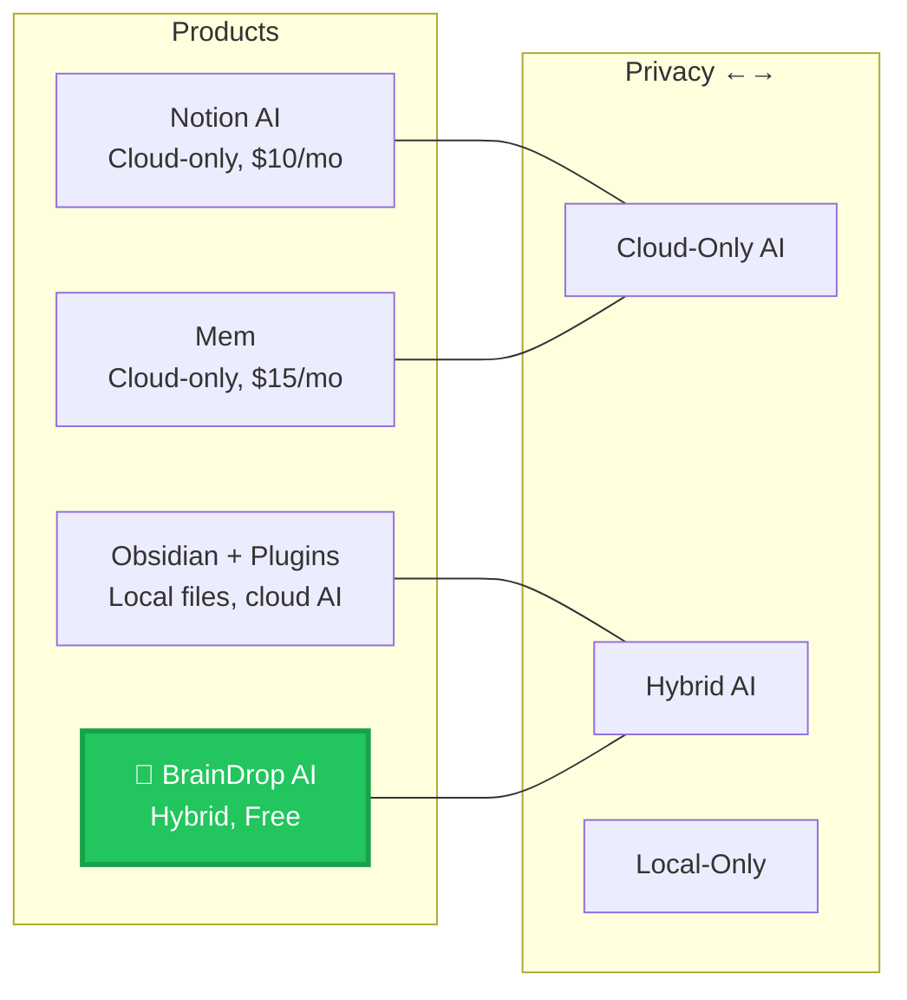

# BrainDrop AI — Product Requirements Document

| Field              | Value                                                        |
| ------------------ | ------------------------------------------------------------ |
| **Document**       | Product Requirements Document (PRD)                          |
| **Product**        | BrainDrop AI — Privacy-First Hybrid AI Knowledge Capture & Research Assistant |
| **Version**        | 1.0.0                                                        |
| **Status**         | ✅ Approved — Active Development                              |
| **Author**         | Tino Nurcahya                                                |
| **Last Updated**   | 2026-11-16                                                   |
| **Live URL**       | [brain.tinonurcahya.dev](https://brain.tinonurcahya.dev)     |
| **Hackathon**      | Google #BuildHybridAI 2026 (Web/Chrome)                      |
| **Deadline**       | December 1, 2026 @ 05:00 AM GMT+7                            |
| **License**        | Apache-2.0                                                   |

> **Tagline:** *"Capture anything, forget nothing — your second brain that never leaves your device."*

---

## Canonical References

| Document                              | Purpose                                      |
| ------------------------------------- | -------------------------------------------- |
| [ARCHITECTURE.md](./ARCHITECTURE.md)  | System architecture, component topology       |
| [AI_SPEC.md](./AI_SPEC.md)            | Hybrid AI inference engine specification      |
| [DATABASE.md](./DATABASE.md)          | Firestore schema, indexes, security rules     |
| [DESIGN.md](./DESIGN.md)              | UI/UX design system, component library        |
| [SPRINT.md](./SPRINT.md)              | Sprint plan, milestones, task breakdown       |

---

## Table of Contents

1. [Executive Summary](#1-executive-summary)
2. [Product Positioning](#2-product-positioning)
3. [Problem Statement](#3-problem-statement)
4. [Solution Overview](#4-solution-overview)
5. [Target Audience & Personas](#5-target-audience--personas)
6. [Core Loop](#6-core-loop)
7. [Feature Requirements](#7-feature-requirements)
8. [Technical Requirements](#8-technical-requirements)
9. [Non-Functional Requirements](#9-non-functional-requirements)
10. [Constraints & Assumptions](#10-constraints--assumptions)
11. [Competitive Landscape](#11-competitive-landscape)
12. [Success Metrics](#12-success-metrics)
13. [Risks & Mitigations](#13-risks--mitigations)
14. [Glossary](#14-glossary)

---

## 1. Executive Summary

BrainDrop AI is a **privacy-first hybrid AI knowledge capture and research assistant** designed for the Google #BuildHybridAI 2026 hackathon. It solves the chronic problem of **information overload** faced by researchers, students, and developers who juggle dozens of browser tabs daily but lose context, forget sources, and fear sending sensitive research data to cloud AI services.

The product ships as two coordinated surfaces — a **Next.js 15 web application** (smart note canvas, knowledge graph, flashcards, research dashboard) and a **Chrome Extension (Manifest V3)** web clipper — unified by a shared monorepo and a single Firestore backend.

What makes BrainDrop AI architecturally distinctive is its **hybrid AI inference model** powered by Firebase AI Logic:

- **On-device processing (Gemini Nano 4)** handles auto-tagging, quick summarization, semantic search, smart linking, and PII detection — entirely in the browser with zero data leakage, sub-50ms latency, and zero API cost.
- **Cloud fallback (Gemini 3.8 Flash)** handles compute-intensive tasks — deep multi-note synthesis, flashcard generation, translation, and content expansion — using only anonymized payloads, with ~800ms latency on the free tier.

A persistent **Privacy Telemetry HUD** gives users complete transparency into what was processed locally versus what was sent to the cloud, creating a trust relationship that no competing product offers.

> [!IMPORTANT]
> This product is simultaneously a hackathon submission and a portfolio piece for Full-Stack Web Engineer job applications targeting remote/overseas and enterprise companies. Every architectural decision must demonstrate professional-grade engineering competence.

---

## 2. Product Positioning

### 2.1 Value Proposition

> Capture web content in one click, organize it with AI that runs on your device, and synthesize research insights — all without your data leaving your browser unless you explicitly allow it.

### 2.2 Positioning Statement

**For** researchers, students, and developers **who** struggle with information overload and tab sprawl, **BrainDrop AI** is a **hybrid AI knowledge assistant** that captures, organizes, and synthesizes web research with privacy-first on-device intelligence. **Unlike** Notion AI, Mem, or Obsidian plugins that route all content through cloud APIs, **BrainDrop AI** processes sensitive data entirely in-browser using Gemini Nano 4 and only falls back to the cloud (Gemini 3.8 Flash) with anonymized content for heavy-compute tasks.

### 2.3 Positioning Matrix

| Dimension           | BrainDrop AI                    | Notion AI           | Mem                 | Obsidian + Copilot  |
| ------------------- | ------------------------------- | ------------------- | ------------------- | ------------------- |
| **AI Location**     | Hybrid (on-device + cloud)      | Cloud-only          | Cloud-only          | Cloud-only          |
| **Privacy**         | PII detection, local-first      | Full cloud upload   | Full cloud upload   | Plugin-dependent    |
| **Web Clipping**    | Native Chrome Extension (MV3)   | Web clipper (basic) | None                | Community plugin    |
| **Knowledge Graph** | Interactive (React Flow)        | None                | Bi-directional      | Community plugin    |
| **Flashcards**      | AI-generated + Leitner SRS      | None                | None                | Community plugin    |
| **Cost**            | Free (Nano) + Free tier (Flash) | $10/mo add-on       | $14.99/mo           | Free + API costs    |
| **Platform**        | Chrome / Web                    | Cross-platform      | Cross-platform      | Desktop             |

---

## 3. Problem Statement

### 3.1 The Information Overload Crisis

Modern knowledge workers, researchers, and students face a compounding information management problem:

1. **Tab Sprawl → Context Loss** — Users routinely open 30+ browser tabs during a single research session. By the time they circle back, they've forgotten which tab held the critical insight, the tab has been closed, or the browser has crashed.

2. **Copy-Paste → Metadata Loss** — The instinctive response is to copy-paste snippets into a notes app. But this strips away critical context: the source URL, the page title, the capture timestamp, and the surrounding text that gave the snippet meaning.

3. **AI Assistance → Privacy Violation** — Users want AI to summarize, connect, and synthesize their notes. But sending personal research data (job search notes, competitive analysis, medical research, interview prep) to cloud AI services creates unacceptable privacy risks.

4. **Scattered Tools → Fragmented Workflow** — Using separate tools for clipping (Evernote), notes (Notion), flashcards (Anki), and visualization (Obsidian graph) creates friction and prevents holistic knowledge synthesis.

### 3.2 Problem Quantification

| Pain Point                         | Severity  | Frequency       | Existing Solutions Adequacy |
| ---------------------------------- | --------- | --------------- | --------------------------- |
| Losing important tab content       | High      | Daily           | ❌ No context capture        |
| Losing source URL/metadata         | High      | Every clip      | ⚠️ Partial (some clippers)   |
| Privacy fear with cloud AI         | Critical  | Every AI query  | ❌ No hybrid option          |
| Can't synthesize across notes      | Medium    | Weekly          | ⚠️ Manual effort             |
| No spaced repetition from notes    | Medium    | During study    | ❌ Separate tool required    |
| Can't visualize knowledge topology | Low–Med   | Monthly         | ⚠️ Community plugins only    |

---

## 4. Solution Overview

### 4.1 Hybrid AI Architecture

The core architectural innovation is a **two-tier AI inference pipeline** that routes tasks to the optimal compute layer:



### 4.2 Task Routing Matrix

| Task                    | Tier       | Model            | Latency  | Data Sent to Cloud | Cost     |
| ----------------------- | ---------- | ---------------- | -------- | ------------------- | -------- |
| Auto-tag clips          | On-Device  | Gemini Nano 4    | ~50ms    | None                | Free     |
| Quick summarize         | On-Device  | Gemini Nano 4    | ~50ms    | None                | Free     |
| Semantic search         | On-Device  | Gemini Nano 4    | ~30ms    | None                | Free     |
| Smart linking           | On-Device  | Gemini Nano 4    | ~50ms    | None                | Free     |
| PII detection           | On-Device  | Gemini Nano 4    | ~40ms    | None                | Free     |
| Simplify text           | On-Device  | Gemini Nano 4    | ~50ms    | None                | Free     |
| Find related notes      | On-Device  | Gemini Nano 4    | ~50ms    | None                | Free     |
| Deep synthesis          | Cloud      | Gemini 3.8 Flash | ~800ms   | Anonymized content  | Free tier|
| Flashcard generation    | Cloud      | Gemini 3.8 Flash | ~1200ms  | Anonymized content  | Free tier|
| Translation             | Cloud      | Gemini 3.8 Flash | ~600ms   | Anonymized content  | Free tier|
| Expand & elaborate      | Cloud      | Gemini 3.8 Flash | ~800ms   | Anonymized content  | Free tier|

### 4.3 Product Surfaces



> [!NOTE]
> Full architecture details including component-level topology, data flow diagrams, and deployment infrastructure are documented in [ARCHITECTURE.md](./ARCHITECTURE.md).

---

## 5. Target Audience & Personas

### 5.1 Primary Persona: Arya — The Hackathon Hustler

| Attribute          | Detail                                                                 |
| ------------------ | ---------------------------------------------------------------------- |
| **Name**           | Arya                                                                   |
| **Age**            | 24                                                                     |
| **Role**           | Software Engineering Fresh Graduate                                    |
| **Location**       | Jakarta, Indonesia                                                     |
| **Device**         | Mid-range Windows laptop, Chrome browser                               |
| **Daily Workflow** | Researches for hackathons, interview prep, and continuous learning      |
| **Tab Count**      | 30–50 tabs daily                                                       |
| **Pain Points**    | Forgets which tab held the answer; notes app strips source URL; wants AI help but doesn't want personal interview prep notes going to cloud |
| **Goals**          | Quickly clip and retrieve research; AI summarization without privacy risk; organize scattered learning materials |
| **Tech Savviness** | High — comfortable with developer tools, Chrome DevTools               |

**Arya's Story:**
> "I'm prepping for interviews while also doing a hackathon. My tabs look like a war zone. I copy stuff to Notion but then I can't remember where I found it. I'd love AI to connect my notes and make flashcards, but I don't want my interview prep notes — salary research, company-specific strategies — going through someone's cloud API."

**Success Criteria for Arya:**
- Can clip any text from any webpage in ≤ 2 clicks
- Source URL and timestamp are automatically preserved
- Can ask AI to summarize notes without data leaving the browser
- Can generate flashcards from interview prep notes
- Can see a knowledge graph connecting related study topics

### 5.2 Secondary Persona: Sarah — The UX Researcher

| Attribute          | Detail                                                                 |
| ------------------ | ---------------------------------------------------------------------- |
| **Name**           | Sarah                                                                  |
| **Age**            | 27                                                                     |
| **Role**           | UX Researcher at a Series B startup                                    |
| **Location**       | Singapore                                                              |
| **Device**         | MacBook Pro, Chrome browser                                            |
| **Daily Workflow** | Clips articles, research papers, competitor analyses                   |
| **Tab Count**      | 20–40 tabs across multiple research projects                           |
| **Pain Points**    | Needs to synthesize multiple sources into research briefs; competitive research is confidential; tools don't connect related findings |
| **Goals**          | Multi-source synthesis; privacy for competitive intelligence; visual map of research landscape |
| **Tech Savviness** | Medium — uses design and research tools, not developer-focused         |

**Sarah's Story:**
> "I'm analyzing 5 competitors for a new feature. I've clipped 40 articles across their blogs, reviews, and case studies. I need AI to pull themes across all of them and generate a brief for my PM. But this is pre-launch competitive intel — I absolutely cannot send it to a cloud AI service unprotected."

**Success Criteria for Sarah:**
- Can organize clips by research project/topic
- Can select multiple notes and get a synthesized research brief
- Knowledge graph shows clusters of related competitive findings
- Privacy telemetry confirms sensitive research stayed on-device

### 5.3 Tertiary Persona: Budi — The Budget Student

| Attribute          | Detail                                                                 |
| ------------------ | ---------------------------------------------------------------------- |
| **Name**           | Budi                                                                   |
| **Age**            | 21                                                                     |
| **Role**           | Computer Science undergraduate                                        |
| **Location**       | Bandung, Indonesia                                                     |
| **Device**         | Chromebook (limited resources), Chrome browser                         |
| **Daily Workflow** | Clips lecture notes, tutorials, documentation                          |
| **Tab Count**      | 15–25 tabs during study sessions                                       |
| **Pain Points**    | Chromebook has limited RAM/storage; can't run heavy local AI models; needs flashcards for exam prep but Anki is too manual; can't afford paid AI tools |
| **Goals**          | Lightweight tool that works on Chromebook; automatic flashcard generation; free AI features |
| **Tech Savviness** | Medium — CS student, growing technical skills                          |

**Budi's Story:**
> "I'm studying data structures for finals. I've been clipping explanations from GeeksforGeeks, YouTube transcripts, and my professor's slides. I need flashcards but I don't want to manually create 200 of them. My Chromebook is slow so the tool can't be heavy."

**Success Criteria for Budi:**
- App loads and runs smoothly on a Chromebook
- Can auto-generate flashcards from clipped lecture notes
- Spaced repetition system helps him prioritize weak topics
- Zero cost for daily usage (on-device AI is free)

---

## 6. Core Loop

The core product loop follows a **Capture → Organize → Augment → Synthesize → Review** cycle:



| Phase         | AI Tier    | User Action                              | System Response                                    |
| ------------- | ---------- | ---------------------------------------- | -------------------------------------------------- |
| **Capture**   | —          | Highlight text → click 🧠 Clip          | Save clip with URL, title, timestamp, selected text |
| **Organize**  | On-Device  | (Automatic on save)                      | Auto-tag, detect related notes, build graph edges   |
| **Augment**   | On-Device  | Click "Summarize" / "Simplify" on a note | Instant on-device summary with zero data leakage    |
| **Synthesize**| Cloud      | Select 3 notes → "Synthesize Brief"      | Multi-note research brief via anonymized cloud call |
| **Review**    | —          | Open knowledge graph / flashcards        | Visual exploration, spaced repetition study mode    |

> [!TIP]
> The core loop is designed to be **progressively engaging**: users start by clipping (low friction), then discover AI features organically as they accumulate notes. The knowledge graph and flashcards become valuable only after a critical mass of 5–10 clips.

---

## 7. Feature Requirements

### 7.1 F-01: Web Clipper Chrome Extension (MV3)

| Field            | Detail                                                   |
| ---------------- | -------------------------------------------------------- |
| **Priority**     | P0 — Must Have                                           |
| **AI Tier**      | On-Device (auto-tagging on save)                         |
| **Personas**     | Arya, Sarah, Budi                                        |
| **Dependencies** | Chrome MV3 APIs, Firebase Auth, Firestore                |

#### 7.1.1 Content Script — Floating Clip Button

- **Trigger:** User selects/highlights text on any webpage.
- **Behavior:** A floating `🧠 Clip` button appears near the selection.
- **Click Action:** Captures the following metadata and saves to Firestore:
  - `selectedText` — The highlighted text content
  - `sourceUrl` — Full URL of the current page
  - `pageTitle` — Document title
  - `timestamp` — ISO 8601 capture timestamp
  - `faviconUrl` — Page favicon for visual identification
  - `surroundingContext` — ±2 paragraphs around the selection (for context)
- **Auto-Tag:** On-device Gemini Nano 4 generates 1–5 tags immediately on save.
- **Feedback:** Toast notification confirming save with tag preview.

#### 7.1.2 Extension Popup — Quick Notes

- **Purpose:** Quick note entry without visiting the web app.
- **Fields:** Title (auto-suggested), body (plain text), manual tags.
- **Recent Clips:** Shows last 5 clips with source favicons.
- **Auth State:** Shows logged-in user avatar; login button if unauthenticated.

#### 7.1.3 Side Panel — Clip Manager

- **Purpose:** Browse, search, and manage clips without leaving the current tab.
- **Features:**
  - Full clip list with infinite scroll
  - Search bar (on-device semantic search via Gemini Nano 4)
  - Tag filter chips
  - Click-to-expand clip detail view
  - "Open in Canvas" action to navigate to the web app editor

#### 7.1.4 Extension Permissions

| Permission            | Justification                                      |
| --------------------- | -------------------------------------------------- |
| `activeTab`           | Read selected text and page metadata               |
| `storage`             | Cache auth token and user preferences              |
| `sidePanel`           | Side panel clip manager                            |
| `identity`            | Firebase Auth via Chrome identity API               |
| `contextMenus`        | Right-click → "Clip to BrainDrop" menu item         |

#### 7.1.5 Acceptance Criteria

```gherkin
Feature: Web Clipper

  Scenario: Clip text from a webpage
    Given I am logged into the BrainDrop extension
    And I am on any webpage
    When I select text on the page
    Then a floating "🧠 Clip" button appears near my selection
    When I click the "🧠 Clip" button
    Then the selected text is saved with source URL, title, and timestamp
    And on-device AI generates 1-5 tags
    And a success toast appears within 500ms

  Scenario: Search clips from side panel
    Given I have 20+ saved clips
    When I open the BrainDrop side panel
    And I type "react hooks" in the search bar
    Then on-device semantic search returns relevant clips
    And results appear within 100ms
```

---

### 7.2 F-02: Smart Note Canvas (Tiptap Editor)

| Field            | Detail                                                   |
| ---------------- | -------------------------------------------------------- |
| **Priority**     | P0 — Must Have                                           |
| **AI Tier**      | On-Device + Cloud (depending on action)                  |
| **Personas**     | Arya, Sarah                                              |
| **Dependencies** | Tiptap, Gemini Nano 4, Gemini 3.8 Flash, Firestore      |

#### 7.2.1 Rich Text Editor

- **Engine:** Tiptap (ProseMirror-based) with custom extensions.
- **Formatting:** Headings (H1–H3), bold, italic, strikethrough, code, blockquote, bullet/numbered lists, horizontal rule, links, images.
- **Clip Integration:** Clips imported into the canvas show a source badge (favicon + URL + timestamp).
- **Auto-Save:** Debounced auto-save to Firestore every 3 seconds after last keystroke.
- **Keyboard Shortcuts:** Standard (Ctrl+B, Ctrl+I, etc.) + custom (Ctrl+Shift+S = summarize selection).

#### 7.2.2 AI Sidebar Actions

The editor includes an AI sidebar with contextual actions. Each action operates on the selected text or the full note:

| Action              | AI Tier    | Input                | Output                            |
| ------------------- | ---------- | -------------------- | --------------------------------- |
| **Summarize**       | On-Device  | Selected text / note | Concise 2-3 sentence summary      |
| **Simplify**        | On-Device  | Selected text / note | ELI5 rewrite at lower complexity   |
| **Expand**          | Cloud      | Selected text        | Elaborated version with detail     |
| **Find Related**    | On-Device  | Current note         | List of related notes with scores  |
| **Translate**       | Cloud      | Selected text / note | Translation to target language     |
| **Synthesize**      | Cloud      | Multiple notes       | Multi-source research brief        |

#### 7.2.3 Acceptance Criteria

```gherkin
Feature: Smart Note Canvas

  Scenario: On-device summarization
    Given I have a note with 500+ words
    When I click "Summarize" in the AI sidebar
    Then a 2-3 sentence summary appears in the sidebar
    And the Privacy HUD increments the on-device ops counter
    And no network request is made to any AI API
    And the response appears within 100ms

  Scenario: Cloud synthesis of multiple notes
    Given I have 3 notes selected about "React Server Components"
    When I click "Synthesize" in the AI sidebar
    Then a research brief combining insights from all 3 notes appears
    And the Privacy HUD increments the cloud ops counter
    And the Privacy HUD shows the anonymized bytes sent
```

---

### 7.3 F-03: Knowledge Graph Visualization

| Field            | Detail                                                   |
| ---------------- | -------------------------------------------------------- |
| **Priority**     | P1 — Should Have                                         |
| **AI Tier**      | On-Device (relationship detection)                       |
| **Personas**     | Sarah, Arya                                              |
| **Dependencies** | React Flow, Gemini Nano 4, Firestore                     |

#### 7.3.1 Graph Rendering

- **Engine:** React Flow with custom node and edge components.
- **Nodes:** Each note/clip is a node displaying title, primary tag, and a truncated preview.
- **Edges:** AI-detected semantic relationships between notes. Edge thickness indicates relationship strength (0.0–1.0 confidence score).
- **Layout:** Force-directed layout with dagre algorithm. Automatic clustering.
- **Cluster Coloring:** Nodes colored by primary tag/topic. Legend sidebar shows color mapping.

#### 7.3.2 Interactive Features

- **Pan & Zoom:** Smooth pan/zoom with mouse and touch gestures.
- **Click Node:** Opens note detail in a slide-over panel.
- **AI Suggestion Banner:** "These 3 notes seem related — merge into a research brief?" with one-click synthesis action.
- **Filter by Tag:** Toggle tag filters to show/hide node clusters.
- **Minimap:** React Flow minimap for orientation in large graphs.
- **Export:** Export graph as PNG for presentations and reports.

#### 7.3.3 Relationship Detection Pipeline



#### 7.3.4 Acceptance Criteria

```gherkin
Feature: Knowledge Graph

  Scenario: Visualize note relationships
    Given I have 10+ notes across 3 topics
    When I navigate to the Knowledge Graph view
    Then I see a force-directed graph with colored clusters
    And notes within the same topic are visually grouped
    And edge thickness reflects relationship confidence

  Scenario: AI-suggested relationship
    Given I save a new note about "React hooks"
    And I have an existing note about "React state management"
    When the on-device AI detects a semantic relationship
    Then a new edge appears connecting the two nodes
    And a banner suggests "These notes seem related"
```

---

### 7.4 F-04: Flashcard Generator

| Field            | Detail                                                   |
| ---------------- | -------------------------------------------------------- |
| **Priority**     | P1 — Should Have                                         |
| **AI Tier**      | Cloud (Gemini 3.8 Flash)                                 |
| **Personas**     | Budi, Arya                                               |
| **Dependencies** | Gemini 3.8 Flash, Firestore, Framer Motion               |

#### 7.4.1 Generation Flow

1. User selects a note or set of clips.
2. Clicks "Generate Flashcards" → triggers cloud AI call with anonymized content.
3. AI returns 5–15 Q&A pairs in structured JSON.
4. User reviews, edits, or deletes individual cards before saving.
5. Cards are saved to Firestore under the user's flashcard deck.

#### 7.4.2 Study Mode

- **Flip Animation:** Framer Motion card flip (front = question, back = answer).
- **Self-Assessment:** User rates recall: "Easy" / "Medium" / "Hard" / "Again."
- **Leitner System:** Basic 5-box spaced repetition:
  - Box 1: Review every session
  - Box 2: Review every 2 sessions
  - Box 3: Review every 4 sessions
  - Box 4: Review every 8 sessions
  - Box 5: Retired (mastered)
- **Progress Bar:** Visual indicator of cards mastered vs. remaining.
- **Session Stats:** Cards reviewed, accuracy rate, time spent.

#### 7.4.3 Card Schema

```typescript
interface Flashcard {
  id: string;
  deckId: string;
  noteId: string;           // Source note reference
  question: string;
  answer: string;
  leitnerBox: 1 | 2 | 3 | 4 | 5;
  nextReviewAt: Timestamp;
  createdAt: Timestamp;
  updatedAt: Timestamp;
  reviewCount: number;
  correctCount: number;
}
```

#### 7.4.4 Acceptance Criteria

```gherkin
Feature: Flashcard Generator

  Scenario: Generate flashcards from a note
    Given I have a note about "Binary Search Trees"
    When I click "Generate Flashcards"
    Then 5-15 Q&A flashcards are generated via cloud AI
    And I can review, edit, or delete each card
    When I save the deck
    Then cards appear in my Flashcard library

  Scenario: Spaced repetition study
    Given I have a deck with 10 flashcards
    And 3 cards are in Box 1 (due now)
    When I start a study session
    Then I see the 3 due cards first
    When I rate a card as "Easy"
    Then it moves to the next Leitner box
```

---

### 7.5 F-05: Research Dashboard

| Field            | Detail                                                   |
| ---------------- | -------------------------------------------------------- |
| **Priority**     | P2 — Nice to Have                                        |
| **AI Tier**      | None (analytics only)                                    |
| **Personas**     | Sarah, Arya                                              |
| **Dependencies** | Recharts / Nivo, Firestore aggregation                   |

#### 7.5.1 Dashboard Components

| Widget                       | Visualization         | Data Source                        |
| ---------------------------- | --------------------- | ---------------------------------- |
| **Clip Timeline Heatmap**    | GitHub-style heatmap  | Clip timestamps (last 12 months)   |
| **Topic Distribution**       | Donut/pie chart       | Tag frequency across all notes     |
| **Reading Progress**         | Stacked bar chart     | Clips read vs. unread per week     |
| **AI Usage Breakdown**       | Split bar chart       | On-device vs. cloud ops over time  |
| **Recent Activity Feed**     | Timeline list         | Last 20 actions (clip, edit, study)|
| **Privacy Telemetry Summary**| Stat cards            | Total local ops, total cloud ops, bytes kept local |

#### 7.5.2 Acceptance Criteria

```gherkin
Feature: Research Dashboard

  Scenario: View clip activity heatmap
    Given I have clips saved across multiple days
    When I navigate to the Research Dashboard
    Then I see a GitHub-style heatmap showing clip activity
    And darker squares indicate higher clip counts
    And I can hover to see exact counts per day
```

---

### 7.6 F-06: Privacy Telemetry HUD

| Field            | Detail                                                   |
| ---------------- | -------------------------------------------------------- |
| **Priority**     | P0 — Must Have                                           |
| **AI Tier**      | Meta (monitors all AI operations)                        |
| **Personas**     | All                                                      |
| **Dependencies** | Zustand state store, Framer Motion                       |

#### 7.6.1 Persistent Bottom Bar

A fixed-position bottom bar visible on all pages, displaying:

| Metric                  | Format               | Example                |
| ----------------------- | -------------------- | ---------------------- |
| On-Device Ops Count     | Counter + icon       | `🟢 142 on-device`    |
| Cloud Ops Count         | Counter + icon       | `☁️ 12 cloud`         |
| Bytes Kept Local        | Human-readable size  | `📦 2.4 MB local`     |
| Avg. On-Device Latency  | Milliseconds         | `⚡ 47ms avg`          |
| Avg. Cloud Latency      | Milliseconds         | `🌐 812ms avg`        |

#### 7.6.2 Expanded Audit Log

Clicking the HUD bar expands a full-screen modal with:

- **Operation Log Table:** Timestamp, operation type, AI tier, input size, output size, latency, anonymization applied (Y/N).
- **Filters:** By date range, AI tier, operation type.
- **Export:** Download audit log as CSV.
- **Privacy Score:** Computed ratio `on_device_ops / total_ops × 100` displayed as a percentage badge (e.g., "94% Private").

#### 7.6.3 Acceptance Criteria

```gherkin
Feature: Privacy Telemetry HUD

  Scenario: Track on-device operations
    Given I summarize a note using on-device AI
    Then the HUD on-device counter increments by 1
    And the bytes-kept-local counter increases
    And no cloud counter is affected

  Scenario: View audit log
    When I click the Privacy Telemetry HUD bar
    Then a modal shows a table of all AI operations
    And each row shows timestamp, tier, latency, and data size
    And I can filter by "On-Device" to see only local operations
```

---

### 7.7 F-07: Demo Mode

| Field            | Detail                                                   |
| ---------------- | -------------------------------------------------------- |
| **Priority**     | P1 — Should Have                                         |
| **AI Tier**      | N/A (uses pre-computed AI outputs)                       |
| **Personas**     | Recruiters, hackathon judges                             |
| **Dependencies** | Seed data, feature flags                                 |

#### 7.7.1 Requirements

- **Pre-loaded Data:** 15–20 sample clips across 3 topics (Web Development, AI/ML, UX Design) with pre-generated tags, relationships, and flashcards.
- **No Sign-Up Required:** Demo mode accessible via `/demo` route without authentication.
- **Full Feature Access:** All features (canvas, graph, flashcards, dashboard, HUD) work with sample data.
- **Read-Only Firestore:** Demo data is read-only; user edits are stored in-memory only and reset on page reload.
- **Banner:** Persistent top banner: "You're in Demo Mode — [Sign up to save your own clips →]"

---

## 8. Technical Requirements

### 8.1 Technology Stack

| Layer               | Technology                      | Version    | Justification                           |
| ------------------- | ------------------------------- | ---------- | --------------------------------------- |
| **Framework**       | Next.js                         | 15.x       | App Router, RSC, hackathon familiarity  |
| **Language**        | TypeScript                      | 5.x        | Type safety, portfolio quality          |
| **Styling**         | Tailwind CSS                    | 4.x        | Rapid UI development, design tokens     |
| **Components**      | shadcn/ui                       | Latest     | Accessible, customizable primitives     |
| **Editor**          | Tiptap                          | 2.x        | ProseMirror-based rich text editing     |
| **Graph**           | React Flow                      | 12.x       | Interactive node graph visualization    |
| **State**           | Zustand                         | 5.x        | Lightweight, TypeScript-first state     |
| **Animation**       | Framer Motion                   | 11.x       | Card flips, page transitions, micro-interactions |
| **AI (On-Device)**  | Firebase AI Logic (Gemini Nano 4)| Latest    | Hackathon requirement, free, private    |
| **AI (Cloud)**      | Firebase AI Logic (Gemini 3.8 Flash) | Latest | Hackathon requirement, free tier        |
| **Auth**            | Firebase Auth                   | Latest     | Google sign-in, anonymous auth          |
| **Database**        | Cloud Firestore                 | Latest     | Real-time sync, offline persistence     |
| **Security**        | Firebase App Check              | Latest     | Hackathon requirement (debug tokens OK) |
| **Hosting**         | Vercel                          | Latest     | Next.js native deployment               |
| **Monorepo**        | Turborepo + npm workspaces      | Latest     | Build orchestration, shared packages    |

### 8.2 Monorepo Structure

```
braindrop-ai/
├── apps/
│   ├── web/                    # Next.js 15 web application
│   │   ├── app/                # App Router pages and layouts
│   │   ├── components/         # UI components
│   │   ├── lib/                # Utilities, hooks, stores
│   │   └── public/             # Static assets
│   └── extension/              # Chrome Extension (MV3)
│       ├── manifest.json       # MV3 manifest
│       ├── content/            # Content scripts
│       ├── popup/              # Extension popup
│       ├── sidepanel/          # Side panel
│       └── background/         # Service worker
├── packages/
│   ├── core/                   # Shared types, constants, utilities
│   │   ├── types/              # TypeScript interfaces
│   │   └── utils/              # Shared helper functions
│   └── ai-logic/               # Hybrid inference engine
│       ├── nano.ts             # On-device Gemini Nano 4 wrapper
│       ├── flash.ts            # Cloud Gemini 3.8 Flash wrapper
│       ├── router.ts           # Task routing logic
│       └── anonymizer.ts       # PII stripping before cloud calls
├── doc/                        # Engineering documentation
├── turbo.json                  # Turborepo pipeline config
├── package.json                # Root package.json
└── tsconfig.json               # Root TypeScript config
```

### 8.3 Firebase Configuration

| Service          | Configuration                                              |
| ---------------- | ---------------------------------------------------------- |
| **Auth**         | Google Sign-In provider + Anonymous Auth for demo mode      |
| **Firestore**    | Multi-region, security rules per-user isolation             |
| **App Check**    | reCAPTCHA Enterprise (prod) + Debug tokens (dev)            |
| **AI Logic**     | Nano 4 (on-device) + Gemini 3.8 Flash (cloud) via `firebase/ai` SDK |

> [!IMPORTANT]
> Firestore security rules MUST enforce per-user document isolation. No user should be able to read or write another user's clips, notes, or flashcards. See [DATABASE.md](./DATABASE.md) for the complete security rules.

### 8.4 Hybrid AI Integration

The `packages/ai-logic` module encapsulates all AI interactions behind a unified interface:

```typescript
// packages/ai-logic/router.ts
import { getAI, getGenerativeModel } from 'firebase/ai';

export type AITier = 'on-device' | 'cloud';

export interface AIRequest {
  task: AITask;
  input: string;
  noteIds?: string[];
}

export interface AIResponse {
  result: string;
  tier: AITier;
  latencyMs: number;
  inputTokens: number;
  outputTokens: number;
  anonymized: boolean;
}

export type AITask =
  | 'summarize'
  | 'simplify'
  | 'auto-tag'
  | 'find-related'
  | 'semantic-search'
  | 'pii-detect'
  | 'expand'
  | 'translate'
  | 'synthesize'
  | 'generate-flashcards';

const ON_DEVICE_TASKS: AITask[] = [
  'summarize', 'simplify', 'auto-tag',
  'find-related', 'semantic-search', 'pii-detect',
];

export async function routeAIRequest(request: AIRequest): Promise<AIResponse> {
  const tier: AITier = ON_DEVICE_TASKS.includes(request.task)
    ? 'on-device'
    : 'cloud';

  if (tier === 'cloud') {
    request.input = await anonymize(request.input);
  }

  const startTime = performance.now();
  const result = await executeInference(tier, request);
  const latencyMs = performance.now() - startTime;

  telemetry.record({ task: request.task, tier, latencyMs });

  return { result, tier, latencyMs, anonymized: tier === 'cloud', ...tokenCounts };
}
```

> [!NOTE]
> Complete AI specification including prompt templates, token budgets, fallback strategies, and error handling is documented in [AI_SPEC.md](./AI_SPEC.md).

---

## 9. Non-Functional Requirements

### 9.1 Performance

| Metric                              | Target         | Measurement Method                 |
| ----------------------------------- | -------------- | ---------------------------------- |
| First Contentful Paint (FCP)        | ≤ 1.5s         | Lighthouse, Web Vitals             |
| Largest Contentful Paint (LCP)      | ≤ 2.5s         | Lighthouse, Web Vitals             |
| Cumulative Layout Shift (CLS)       | ≤ 0.1          | Lighthouse, Web Vitals             |
| Interaction to Next Paint (INP)     | ≤ 200ms        | Web Vitals                         |
| On-device AI response               | ≤ 100ms (p95)  | Privacy Telemetry HUD              |
| Cloud AI response                   | ≤ 2000ms (p95) | Privacy Telemetry HUD              |
| Clip save end-to-end                | ≤ 500ms        | Extension performance logs         |
| Knowledge graph render (100 nodes)  | ≤ 1000ms       | React Flow performance profiling   |
| Auto-save debounce                  | 3s after last keystroke | Firestore write logs        |

### 9.2 Scalability

| Dimension                  | Target                                        |
| -------------------------- | --------------------------------------------- |
| Notes per user             | ≤ 10,000                                      |
| Clips per user             | ≤ 50,000                                      |
| Flashcards per user        | ≤ 20,000                                      |
| Knowledge graph nodes      | ≤ 500 visible at once (virtualization beyond)  |
| Concurrent users           | N/A (Firestore auto-scales, Vercel edge)      |

### 9.3 Security

| Requirement                          | Implementation                               |
| ------------------------------------ | --------------------------------------------- |
| Authentication                       | Firebase Auth (Google Sign-In)                |
| Authorization                        | Firestore security rules (per-user isolation) |
| API Protection                       | Firebase App Check                            |
| Data in transit                      | HTTPS/TLS everywhere                          |
| Data at rest                         | Firestore default encryption (Google-managed) |
| PII in cloud AI calls               | On-device PII detection → strip before send   |
| Content Security Policy             | Strict CSP headers via Next.js config          |
| Extension permissions               | Minimal required permissions (no `<all_urls>`) |

### 9.4 Accessibility

| Standard         | Target                                                    |
| ---------------- | --------------------------------------------------------- |
| WCAG Level       | 2.1 AA (best effort within hackathon timeline)            |
| Keyboard Nav     | All interactive elements focusable and operable           |
| Screen Reader    | Semantic HTML, ARIA labels on custom components           |
| Color Contrast   | Minimum 4.5:1 ratio for text, 3:1 for large text          |
| Motion           | Respect `prefers-reduced-motion` media query               |
| Focus Indicators | Visible focus rings on all interactive elements            |

### 9.5 Reliability

| Metric                    | Target         |
| ------------------------- | -------------- |
| Web app uptime            | 99.5% (Vercel) |
| Firestore availability    | 99.999% (SLA)  |
| Offline capability        | Firestore offline persistence for reads |
| Extension crash recovery  | Service worker auto-restart (MV3)       |
| Data loss prevention      | Auto-save + Firestore journaling        |

### 9.6 Browser Support

| Browser         | Version    | Support Level |
| --------------- | ---------- | ------------- |
| Chrome          | 128+       | Full (extension + web app) |
| Chrome (Android)| 128+       | Web app only (no extension) |
| Edge            | 128+       | Web app only  |
| Firefox         | N/A        | Not supported (Gemini Nano requires Chrome) |
| Safari          | N/A        | Not supported (Gemini Nano requires Chrome) |

> [!WARNING]
> Gemini Nano 4 (on-device AI) requires Chrome 128+ with the `chrome://flags/#optimization-guide-on-device-model` flag enabled. This is a hard platform constraint imposed by the hackathon's hybrid AI requirement.

---

## 10. Constraints & Assumptions

### 10.1 Hackathon Constraints

| Constraint                                | Impact                                        |
| ----------------------------------------- | --------------------------------------------- |
| Must use Firebase AI Logic with hybrid inference | Architecture locked to Firebase AI SDK   |
| Firebase App Check required               | Must configure reCAPTCHA or debug tokens       |
| Public GitHub repo with Apache-2.0        | No proprietary code or secrets in repo         |
| 3-minute YouTube demo video in English    | Must record and edit demo video before deadline|
| Live hosted demo URL                      | Must deploy to Vercel with working demo mode   |
| Devpost submission with text description  | Must write compelling project description      |
| Deadline: Dec 1, 2026 @ 05:00 AM GMT+7   | ~15 days of development time                   |

### 10.2 Technical Constraints

| Constraint                                | Mitigation                                     |
| ----------------------------------------- | ---------------------------------------------- |
| Gemini Nano 4 only in Chrome 128+         | Graceful fallback messaging for other browsers |
| Nano 4 context window limited (~1024 tokens) | Chunk large inputs, summarize in stages     |
| Free tier rate limits on Gemini 3.8 Flash | Queue & retry with exponential backoff         |
| Solo developer + AI coding agents         | Aggressive scope prioritization (P0/P1/P2)     |
| Chromebook performance (Budi persona)     | Lazy loading, code splitting, virtualization   |

### 10.3 Assumptions

1. Chrome's Gemini Nano 4 API remains stable and available through the hackathon period.
2. Firebase AI Logic SDK supports both on-device and cloud inference as documented.
3. Gemini 3.8 Flash free tier provides sufficient quota for demo and judging.
4. Hackathon judges will evaluate on a modern Chrome browser (128+).
5. Firebase App Check debug tokens are acceptable for the hackathon submission.
6. Vercel's free tier provides sufficient bandwidth for the demo period.

---

## 11. Competitive Landscape

### 11.1 Direct Competitors



### 11.2 Differentiation Summary

BrainDrop AI occupies a unique position as the **only free, browser-native, hybrid AI knowledge tool** with:
- Native Chrome extension for zero-friction clipping
- On-device AI that truly keeps data local
- Privacy telemetry for complete transparency
- Integrated knowledge graph visualization
- AI-powered flashcard generation with spaced repetition

---

## 12. Success Metrics

### 12.1 Hackathon Success Metrics

| Metric                                   | Target                    | Measurement               |
| ---------------------------------------- | ------------------------- | -------------------------- |
| Submission completeness                  | All required deliverables | Devpost checklist          |
| Demo video quality                       | 3-min, polished, English  | YouTube view + engagement  |
| Live demo stability                      | Zero crashes during judging | Vercel uptime monitoring |
| Hybrid AI demonstration                  | Both tiers shown in demo  | Demo script coverage       |
| Feature coverage                         | All P0 + ≥2 P1 features  | Feature checklist          |

### 12.2 Portfolio Success Metrics

| Metric                                   | Target                    | Measurement               |
| ---------------------------------------- | ------------------------- | -------------------------- |
| Code quality                             | TypeScript strict, no `any` | ESLint + tsc reports     |
| Documentation quality                    | 5+ comprehensive docs     | Doc directory review       |
| Architecture sophistication              | Monorepo + hybrid AI      | GitHub repo assessment     |
| Lighthouse score                         | ≥ 90 Performance          | Lighthouse CI              |
| Recruiter engagement                     | ≥ 5 demo mode sessions    | Analytics (if implemented) |

### 12.3 Product Success Metrics (Post-Hackathon, Aspirational)

| Metric                                   | Target (90 days)          | Measurement               |
| ---------------------------------------- | ------------------------- | -------------------------- |
| Registered users                         | 100                       | Firebase Auth analytics    |
| Clips saved                              | 1,000                     | Firestore aggregation      |
| AI operations (on-device)               | 5,000                     | Telemetry HUD logs         |
| Privacy score (avg across users)         | ≥ 80%                     | Telemetry computation      |
| Chrome Web Store rating                  | ≥ 4.0 / 5.0              | Store listing              |

---

## 13. Risks & Mitigations

| #  | Risk                                        | Probability | Impact   | Mitigation                                                  |
| -- | ------------------------------------------- | ----------- | -------- | ----------------------------------------------------------- |
| R1 | Gemini Nano 4 API changes before deadline   | Low         | Critical | Pin SDK version, test weekly, have cloud-only fallback       |
| R2 | Free tier rate limits hit during judging     | Medium      | High     | Implement request queuing, cache AI responses, use demo mode |
| R3 | Scope creep delays P0 delivery              | High        | Critical | Strict P0/P1/P2 prioritization, cut P2 features if needed   |
| R4 | Chrome extension review delays              | Medium      | Medium   | Submit early, use unlisted/dev mode for hackathon            |
| R5 | Solo developer burnout                      | Medium      | High     | Time-box daily work, leverage AI coding agents aggressively  |
| R6 | Firestore costs exceed free tier            | Low         | Medium   | Implement document read caching, optimize queries            |
| R7 | React Flow performance with large graphs    | Medium      | Medium   | Virtualize nodes beyond 500, limit visible edges             |
| R8 | Tiptap bundle size impacts performance      | Low         | Low      | Lazy-load editor, code-split Tiptap extensions               |

---

## 14. Glossary

| Term                   | Definition                                                                   |
| ---------------------- | ---------------------------------------------------------------------------- |
| **Clip**               | A saved text snippet captured from a webpage via the Chrome extension         |
| **Note**               | A rich-text document created or edited in the Smart Note Canvas               |
| **Hybrid AI**          | Architecture using both on-device and cloud AI models for different tasks     |
| **On-Device AI**       | AI inference running entirely in the user's browser (Gemini Nano 4)           |
| **Cloud AI**           | AI inference running on Google's servers (Gemini 3.8 Flash)                   |
| **Privacy Telemetry**  | Transparent tracking of which data was processed locally vs. sent to cloud    |
| **Anonymization**      | Stripping PII and identifying information before sending content to cloud AI  |
| **Leitner System**     | A spaced repetition method using 5 boxes with increasing review intervals     |
| **MV3**               | Chrome Extension Manifest Version 3 — the current extension platform standard |
| **Firebase AI Logic**  | Firebase SDK for hybrid AI inference (on-device + cloud models)               |
| **App Check**          | Firebase service that protects backend resources from abuse                   |
| **Knowledge Graph**    | Visual representation of note relationships as an interactive node graph      |
| **Research Brief**     | AI-synthesized summary combining insights from multiple notes/clips           |
| **Demo Mode**          | Pre-loaded sample data allowing exploration without authentication            |
| **PII**               | Personally Identifiable Information (names, emails, phone numbers, etc.)      |
| **SRS**               | Spaced Repetition System — learning technique with scheduled review intervals |

---

> [!NOTE]
> This is a living document. As development progresses through the sprint plan defined in [SPRINT.md](./SPRINT.md), features may be re-prioritized based on time constraints. P0 features are non-negotiable for hackathon submission. P1 features are strongly targeted. P2 features are stretch goals.

---

*Document authored by Tino Nurcahya. Last updated 2026-11-16.*

