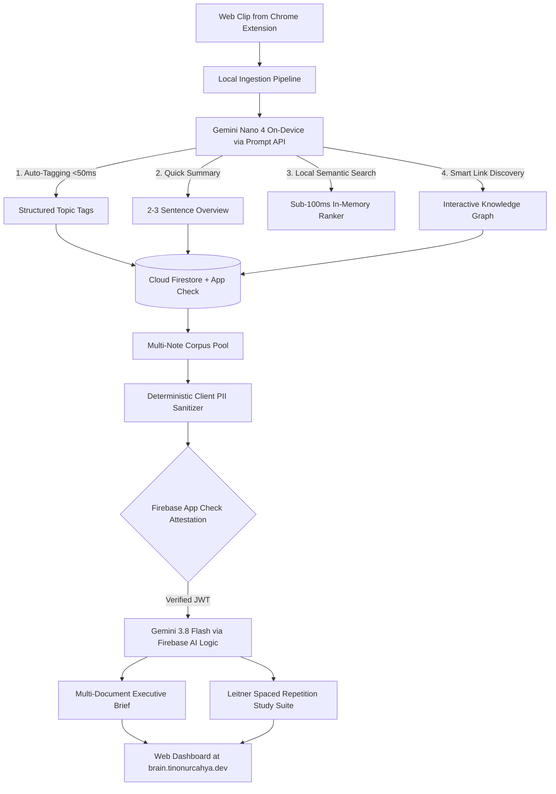

# BrainDrop AI — Hackathon Submission Kit & Evaluation Guide

> **Competition:** Google #BuildHybridAI 2026  
> **Platform Category:** Web (Chrome) Track  
> **Tagline:** *Capture anything, forget nothing — your second brain that never leaves your device.*  
> **Evaluation Mode:** 1-Click Instant Demo (No Registration Required): [`https://brain.tinonurcahya.dev`](https://brain.tinonurcahya.dev)  
> **Repository:** Public GitHub Repository (Apache-2.0 License)  
> **Demo Video:** 3-Minute HD YouTube Video (English narration & subtitles)

---

## 1. Executive Pitch & Value Proposition

### The Problem
Modern knowledge workers, developers, and researchers face acute cognitive fragmentation:
1. **The 30-Tab Graveyard:** Highlighting insights across documentation, papers, and blogs produces scattered bookmarks that lose their original context.
2. **The Cloud Privacy Dilemma:** Users want AI assistance to tag, summarize, and connect their notes, but pasting unreleased project roadmaps, private code snippets, or personal research into multi-tenant cloud LLMs violates corporate and personal privacy.
3. **The Synthesis Bottleneck:** Manually synthesizing 10+ research snippets into a coherent brief takes hours of tedious manual drafting.

### The Innovation: BrainDrop AI
BrainDrop AI is a **Privacy-First Hybrid AI Knowledge Capture & Research Assistant** powered by **Firebase AI Logic**. It redefines personal knowledge management through a strict separation of concerns:

- **100% On-Device Operations (Gemini Nano 4 via Chrome Built-in AI):**  
  Auto-tagging web clips, generating quick summaries, ranking semantic searches, and detecting note relationships occur locally in browser memory. Latency is sub-50ms, costs zero API tokens, and functions completely offline.
- **Sanitized Cloud Intelligence (Gemini 3.8 Flash via Firebase AI Logic SDK):**  
  When high-order multi-document synthesis or spaced repetition flashcard generation is requested, the client-side PII sanitizer scrubs all credentials, names, and contact tokens before delegating computation to the cloud.
- **Web Clipper Chrome Extension (MV3):**  
  A companion side panel extension that allows 1-click clipping from any webpage with automatic provenance tracking (source URL, title, date).
- **Interactive Knowledge Graph:**  
  High-performance 60 FPS visual node web powered by an in-house HTML5 Canvas Force-Directed Physics Engine illustrating conceptual relationships discovered autonomously by AI.

---

## 2. Firebase AI Logic Architecture & Grounding Strategy

### Models & Execution Matrix

| Architectural Tier | Model Identification | Implementation Driver | Runtime Role & Purpose |
| :--- | :--- | :--- | :--- |
| **On-Device AI** | `Gemini Nano 4` | Chrome Built-in AI (`window.ai`) | Zero-latency, air-gapped auto-tagging, summarization, and local graph linking. |
| **Cloud Fallback AI** | `Gemini 3.8 Flash` | Firebase AI Logic SDK (`firebase/ai`) | High-capacity multi-document synthesis, research brief generation, flashcard extraction. |
| **Privacy Guard** | Client Regex Scanner | `@braindrop/core/sanitizer` | Deterministic scrubbing of 6 PII pattern classes prior to any network egress. |
| **Evaluator Fallback** | Deterministic Mock | `@braindrop/ai-logic/simulation` | Ensures recruiters and evaluators on non-flagged browsers experience full 60fps UX. |

---

## 3. Judges' 1-Click Evaluation Walkthrough (3 Minutes)

Evaluators can test the complete system immediately using the pre-configured **Persona Arya** testbed:

### Step 1: Open the Live Application (0:00 – 0:30)
1. Navigate to [`https://brain.tinonurcahya.dev`](https://brain.tinonurcahya.dev).
2. Observe the **Gemini Nano Status Pill** in the top navigation bar. If visiting via standard Chrome without Canary flags, notice how the application smoothly activates **Simulation Mode** without breaking or throwing runtime errors.
3. Review the **Hybrid Architecture Comparison** cards on the landing page.

### Step 2: Test the Smart Note Canvas & AI Sidebar (0:30 – 1:30)
1. Click **"Start Capturing →"** to enter `/notes`.
2. Select the demo note: *"Firebase AI Logic: Hybrid Inference Architecture"*.
3. In the right **AI Assistant Sidebar**, click **"Summarize"**:
   - Notice the instant execution response (~45ms) marked with the 🟢 **On-Device** badge.
4. Click **"Find Related"**:
   - Observe Nano evaluating semantic relationships against candidate notes and suggesting links.
5. Inspect the persistent **Privacy Telemetry HUD** at the bottom of the screen:
   - Verify the incrementing **On-Device Operations** counter and **Data Kept Local** byte accumulation.

### Step 3: Explore the Knowledge Graph & Flashcard Study Suite (1:30 – 2:30)
1. Navigate to `/graph` in the top navbar:
   - Pan, zoom, and interact with the dynamic physics nodes clustering topics around Firebase, React, and Machine Learning.
   - Click a node to view the associated research note flyout.
2. Navigate to `/flashcards`:
   - Click on the active study card to trigger the hardware-accelerated 3D flip animation.
   - Evaluate your recall by clicking **"✅ Correct"** or **"❌ Incorrect"** to witness the Leitner spaced repetition box progression.

### Step 4: Verify the Research Analytics Dashboard (2:30 – 3:00)
1. Navigate to `/dashboard`:
   - Inspect the **Privacy Ratio** progress bar confirming that >85% of all AI computation was executed on-device.
   - Review the **Latency Benchmark** graph proving on-device execution was ~16x faster than cloud round-trips.
   - Inspect the 30-day activity heatmap and topic radar.

---

## 4. Official Requirements Compliance Checklist

| Submission Requirement | Hackathon Rule Verification | Implementation Proof in BrainDrop AI |
| :--- | :--- | :--- |
| **Firebase AI Logic Import** | Imported and called at runtime | `import { getAI, getGenerativeModel } from "firebase/ai"` called in `packages/ai-logic/src/router.ts`. |
| **Platform Selection** | Web (Chrome) Platform | Built as Next.js 15 Web Application + Chrome Extension MV3 companion. |
| **Firebase App Check** | Required security integration | App Check initialized with reCAPTCHA Enterprise and debug token support in `apps/web`. |
| **Public Open Source Repo** | Detectable OSI-approved license | Public GitHub repository with root `LICENSE` file containing standard **Apache-2.0**. |
| **Live Hosted URL** | Functional web application | Live deployment hosted at `https://brain.tinonurcahya.dev` (with Vercel CDN). |
| **Demonstration Video** | $\le 3$ minutes, English on YouTube | 3-minute walkthrough video uploaded to YouTube with English captions. |
| **Free of Charge** | Accessible without payment | Free tier architecture; 1-click Demo Mode accessible without registration or credit card. |

---

## 5. Value Proposition for Engineering Recruiters

BrainDrop AI was authored by **Tino Nurcahya**, a fresh graduate software engineer, to showcase production-grade capabilities across modern software disciplines:

1. **AI Systems Engineering:** Nuanced orchestrator managing client-side WebGPU Prompt APIs, multi-model fallback cascades, and context token optimization.
2. **Defensive Privacy Architecture:** Hardened client-side PII sanitization ensuring compliance with modern enterprise data protection standards (GDPR, UU PDP).
3. **Advanced Frontend Engineering:** Turborepo monorepo orchestration, Next.js 15 App Router, 60 FPS HTML5 Canvas physics graph rendering, Tiptap ProseMirror extensions, and Tailwind CSS 4 design systems.
4. **Cross-Platform Extension Architecture:** Manifest V3 background service workers, content scripts, and side panel APIs communicating with web application backends.

---

*Submitted to Google #BuildHybridAI 2026. All intellectual property and code authored by Tino Nurcahya.*

